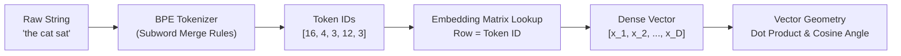

# Module 01: Primitives & Embeddings

> Stripping away the "semantic intelligence" illusion: Tokenizers are dictionary merges, and embeddings are coordinates in $N$-dimensional space.

---

## Visual Mental Model: From Raw Text to Vector Space

Before writing code or formulas, examine how a string travels through the foundational AI pipeline:

```
+---------------------------------------------------------------------------------------------------------+
|                                    DATA TRANSFORMATION PIPELINE                                         |
+---------------------------------------------------------------------------------------------------------+
|  [Raw String]         "the cat sat"                                                                     |
|       |                                                                                                 |
|       v                                                                                                 |
|  [BPE Tokenizer]      Iteratively merges frequent character pairs using a static lookup table           |
|       |                                                                                                 |
|       v                                                                                                 |
|  [Token IDs]          [16, 4, 3, 12, 3]  (Pure integer array)                                           |
|       |                                                                                                 |
|       v                                                                                                 |
|  [Embedding Matrix]   Token ID acts as row index: Vector = Embedding_Weights[Token_ID]                  |
|       |               Matrix shape: (Vocabulary_Size x Dimension), e.g. (50,257 x 768) in GPT-2         |
|       v                                                                                                 |
|  [Dense Vector]       [0.0241, -0.0812, 0.4510, ..., 0.0093] (List of 16- or 32-bit floats)             |
|       |                                                                                                 |
|       v                                                                                                 |
|  [Vector Geometry]    Cosine Similarity = cos(theta) = (u . v) / (||u|| * ||v||)                        |
|                       On unit sphere (||u|| = 1): Cosine Similarity == Dot Product                      |
+---------------------------------------------------------------------------------------------------------+
```



---

## 1. Demystifying Tokens & Byte Pair Encoding (BPE)

Large Language Models do not read characters, syllables, or words. They read **Token IDs**—integers referencing an indexed dictionary.

### Why Not Words or Characters?
1. **Character-level Tokenization:**
   - Text length in tokens explodes ($4\times$ to $5\times$ longer).
   - The attention step costs $\mathcal{O}(L^2)$ in sequence length $L$, so $4\times$ more tokens means about $16\times$ more attention compute. (The rest of the network grows linearly with $L$.)
2. **Word-level Tokenization:**
   - Vocabulary explodes to hundreds of thousands of words.
   - Cannot handle prefixes, suffixes, misspellings, or Out-Of-Vocabulary (OOV) terms (e.g., `microarchitecture` vs `micro-architecture`).

### The Subword Solution: Byte Pair Encoding (BPE)
BPE solves both issues by starting with base characters (or UTF-8 bytes) and iteratively merging the most frequent adjacent character pairs across a training corpus into new subwords.

```
Initial vocabulary: 'l', 'o', 'w', 'e', 'r', 'n', 's', 't', 'i', 'd', '</w>'
Word splits:
  ("l", "o", "w", "</w>") : 5
  ("l", "o", "w", "e", "r", "</w>") : 2
  ("n", "e", "w", "e", "s", "t", "</w>") : 6
  ("w", "i", "d", "e", "s", "t", "</w>") : 3

Merge 1: ('e', 's')     9 times (newest 6 + widest 3)  -> 'es'
         (('s', 't') and ('t', '</w>') also occur 9 times; ties go to the pair counted first)
Merge 2: ('es', 't')    9 times                        -> 'est'
Merge 3: ('est', '</w>') 9 times                       -> 'est</w>'
Merge 4: ('l', 'o')     7 times (low 5 + lower 2)      -> 'lo'
Merge 5: ('lo', 'w')    7 times                        -> 'low'
```

### Runnable Implementation (Pure Python)

Here is the BPE pair-counting and merge step in about 40 lines of standard Python:

```python
import collections
import re

def get_stats(splits: dict[tuple[str, ...], int]) -> dict[tuple[str, str], int]:
    pairs: dict[tuple[str, str], int] = collections.defaultdict(int)
    for word_tuple, freq in splits.items():
        for i in range(len(word_tuple) - 1):
            pairs[(word_tuple[i], word_tuple[i + 1])] += freq
    return pairs

def merge_pair(pair: tuple[str, str], splits: dict[tuple[str, ...], int]) -> dict[tuple[str, ...], int]:
    first, second = pair
    new_splits = {}
    for word_tuple, freq in splits.items():
        new_tuple = []
        i = 0
        while i < len(word_tuple):
            if i < len(word_tuple) - 1 and word_tuple[i] == first and word_tuple[i + 1] == second:
                new_tuple.append(first + second)
                i += 2
            else:
                new_tuple.append(word_tuple[i])
                i += 1
        new_splits[tuple(new_tuple)] = freq
    return new_splits

# Verification: Train on toy corpus and assert merge
corpus = "low low low lower lower newest newest newest"
words = collections.Counter(re.findall(r"\S+", corpus))
splits = {tuple(list(w) + ["</w>"]): freq for w, freq in words.items()}

# Find top pair
pair_stats = get_stats(splits)
top_pair = max(pair_stats, key=pair_stats.get)
splits = merge_pair(top_pair, splits)

# ('l', 'o'), ('o', 'w') and ('w', 'e') each occur 5 times; max() keeps the first one it counted.
assert top_pair == ("l", "o") and pair_stats[top_pair] == 5
assert ("lo", "w", "</w>") in splits  # 'low' is now three symbols instead of four
print(f"Top discovered pair: {top_pair}")
```

*Companion script:* For the full encoder/decoder with deterministic IDs and round-trip verification, inspect [`bpe_tokenizer.py`](bpe_tokenizer.py).

---

## 2. What an Embedding Vector Actually Is

There is zero "magic" or "conceptual consciousness" in an embedding.

An **embedding vector** is simply an array of 32-bit floating-point numbers:
$$\mathbf{v} = [v_1, v_2, \dots, v_D] \in \mathbb{R}^D$$

Typical dimensions ($D$) are 768, 1536, or 3072.

### Two Different Things Are Called "Embeddings"

1. **Token embeddings** live inside a language model: one learned row per vocabulary entry, fetched by
   index (below). They are the model's *input*.
2. **Text embeddings** (the vectors you store for search, sections 3-5) are the *output* of a whole
   encoder model run over a sentence or passage and pooled into one vector. They are not a table lookup.

Whether two text embeddings are close depends on what that model was trained to do. "Similar" in vector
space means "similar according to this model's training objective", which may or may not match what your
users mean by similar. Measure it on your own data before you rely on it.

### The Embedding Layer Is Just a Matrix Lookup
In a neural network, the embedding layer is a matrix $W_e \in \mathbb{R}^{V \times D}$, where $V$ is the vocabulary size and $D$ is the embedding dimension.

When a token ID (e.g., `42`) passes into an embedding layer, the operation is literally an array index:

$$\mathbf{v}_{\text{token}} = W_e[42]$$

```
Embedding Weights Matrix (V x D):
Row 0:  [ 0.012, -0.045,  0.812, ... ] -> Token ID 0  ("!")
Row 1:  [-0.104,  0.512, -0.009, ... ] -> Token ID 1  ("the")
...
Row 42: [ 0.441, -0.198,  0.034, ... ] -> Token ID 42 ("kernel")
```

During training, backpropagation adjusts these weights so that tokens occurring in similar linguistic contexts tend to end up pointing in similar directions in $D$-dimensional space.

---

## 3. Pure Python Vector Math: The Mechanics of Similarity

A vector database adds approximate-nearest-neighbour indexing, filtering, persistence and replication. The scoring underneath is three basic geometric operations:

1. **Dot Product:** Measures directional alignment weighted by length.
2. **Euclidean Norm (L2):** Measures geometric length from the origin.
3. **Cosine Similarity:** The cosine of the angle $\theta$ between two vectors.

```
                    Vector B
                   ^
                  /
                 / 
                /   Angle theta
               / ) 
              +-------------> Vector A
            Origin (0,0)

  cos(theta) = (A . B) / (||A|| * ||B||)
```

### The Core Formulas

$$\text{Dot Product: } \mathbf{u} \cdot \mathbf{v} = \sum_{i=1}^D u_i v_i$$

$$\text{Euclidean Norm: } \|\mathbf{u}\| = \sqrt{\sum_{i=1}^D u_i^2}$$

$$\text{Cosine Similarity: } \cos(\theta) = \frac{\mathbf{u} \cdot \mathbf{v}}{\|\mathbf{u}\| \|\mathbf{v}\|}$$

$$\text{Euclidean Distance: } d(\mathbf{u}, \mathbf{v}) = \|\mathbf{u} - \mathbf{v}\| = \sqrt{\sum_{i=1}^D (u_i - v_i)^2}$$

### The Critical Optimization: Unit Normalization

A square root and a division per comparison add up during high-throughput search. Many vector systems therefore pre-normalize every vector to unit length ($\|\mathbf{u}\| = 1.0$):

$$\hat{\mathbf{u}} = \frac{\mathbf{u}}{\|\mathbf{u}\|}$$

When $\|\hat{\mathbf{u}}\| = 1$ and $\|\hat{\mathbf{v}}\| = 1$:

$$\cos(\theta) = \frac{\hat{\mathbf{u}} \cdot \hat{\mathbf{v}}}{1 \times 1} = \hat{\mathbf{u}} \cdot \hat{\mathbf{v}} = \sum_{i=1}^D \hat{u}_i \hat{v}_i$$

Furthermore, on the unit hypersphere, Euclidean distance and Cosine similarity are strictly linked by a fixed algebraic identity:

$$\|\hat{\mathbf{u}} - \hat{\mathbf{v}}\|^2 = \|\hat{\mathbf{u}}\|^2 + \|\hat{\mathbf{v}}\|^2 - 2(\hat{\mathbf{u}} \cdot \hat{\mathbf{v}}) = 1 + 1 - 2\cos(\theta) = 2 - 2\cos(\theta)$$

Thus:
$$\|\hat{\mathbf{u}} - \hat{\mathbf{v}}\| = \sqrt{2(1 - \cos(\theta))}$$

**Engineering Takeaway:** Sorting by descending cosine similarity is mathematically identical to sorting by ascending Euclidean distance on normalized vectors, and both reduce to a single BLAS dot product (`x . y`).

---

## 4. Copy-Paste Runnable: Vector Math & Naive Vector Search

Copy and run this self-contained script. Zero libraries, standard library only:

```python
import math
from typing import Sequence

def dot_product(u: Sequence[float], v: Sequence[float]) -> float:
    return sum(ui * vi for ui, vi in zip(u, v))

def norm(u: Sequence[float]) -> float:
    return math.sqrt(sum(ui * ui for ui in u))

def normalize(u: Sequence[float]) -> list[float]:
    mag = norm(u)
    if mag == 0.0:
        raise ValueError("Cannot normalize a zero vector.")
    return [ui / mag for ui in u]

def cosine_similarity(u: Sequence[float], v: Sequence[float]) -> float:
    return dot_product(u, v) / (norm(u) * norm(v))

def euclidean_distance(u: Sequence[float], v: Sequence[float]) -> float:
    return math.sqrt(sum((ui - vi) ** 2 for ui, vi in zip(u, v)))

# --- INVARIANT PROOFS & ASSERTIONS ---
eps = 1e-9

# Proof 1: Orthogonal vectors (90 deg) have 0.0 similarity
assert abs(cosine_similarity([1.0, 0.0], [0.0, 1.0]) - 0.0) < eps

# Proof 2: Scalar multiples have 1.0 similarity (length does not affect angle)
assert abs(cosine_similarity([1.0, 2.0, 3.0], [10.0, 20.0, 30.0]) - 1.0) < eps

# Proof 3: Dot product of normalized vectors equals direct cosine similarity
a = [0.4, -1.2, 3.9]
b = [2.1, 0.5, -0.8]
a_norm = normalize(a)
b_norm = normalize(b)
assert abs(dot_product(a_norm, b_norm) - cosine_similarity(a, b)) < eps

# Proof 4: The Euclidean Distance to Cosine Identity
dist_sq = euclidean_distance(a_norm, b_norm) ** 2
expected_dist_sq = 2.0 - 2.0 * dot_product(a_norm, b_norm)
assert abs(dist_sq - expected_dist_sq) < eps

print("All mathematical invariants verified successfully.")
```

*Companion script:* See [`cosine_math.py`](cosine_math.py) for the complete implementation with the 25-line `VectorIndexNaive` search engine.

---

## 5. When NOT to Use Embeddings (Architecture Waste & Anti-Patterns)

Deploying a vector database and an embedding API for every text retrieval problem is a common and expensive mistake.

### Failure Mode 1: Exact Codes, UUIDs, SKUs, and Function Names
Dense embeddings project strings into semantic neighborhoods. They are fundamentally incapable of reliable exact-match filtering.

- **The Problem:** The embeddings for `ERR_SYS_403_AUTH` and `ERR_SYS_404_NOTFOUND` can score very close to each other, because both appear in similar contexts in technical text. (How close depends on the model; measure it with yours.)
- **The Result:** When a user queries for an exact error code, vector search routinely returns completely different errors that "sound similar".
- **The Boring Fix:** A standard hash map, SQL `WHERE error_code = ?`, or SQLite FTS5 index executes in sub-millisecond time with $100\%$ precision.

### Failure Mode 2: Network Latency & Token Tax
Vector search requires an upfront embedding computation for every single incoming search query:

```
[User Query] 
     |
     +--> [HTTP Post to OpenAI/Cohere Embedding API]  (80ms - 250ms latency)
     |
     +--> [Network Transit & JSON Serialization]       (10ms - 30ms latency)
     |
     +--> [Vector DB Nearest Neighbor Scan]            (5ms - 20ms latency)
     |
     Total Query Latency: ~100ms - 300ms
```

These are illustrative ranges for a hosted embedding API. A local embedding model removes the network hops,
but every query still pays for one forward pass through the model.

In contrast:
```
[User Query]
     |
     +--> [SQLite FTS5 / BM25 In-Memory Scan]          (0.8ms latency)
     |
     Total Query Latency: < 1ms
```

### Failure Mode 3: Domain Shift and Vocabulary Mismatch
General-purpose embedding models (e.g., `text-embedding-3-small`, `all-MiniLM-L6-v2`) are trained on general-purpose text. They do not know your proprietary database column names, internal microservice abbreviations, or domain-specific accounting codes.

---

## Decision Matrix: Embeddings vs. Boring Traditional Retrieval

Use this matrix to challenge whether your architecture actually needs dense vector embeddings:

| Evaluation Dimension | Exact String / Regex / Grep | SQLite FTS5 / BM25 Inverted Index | Dense Vector Embeddings |
|---|---|---|---|
| **Query Latency** | **$0.1\text{ ms} - 5\text{ ms}$** | **$0.5\text{ ms} - 10\text{ ms}$** | Tens to hundreds of ms with a hosted API; less with a local model |
| **API Cost per Query** | **\$0.00** | **\$0.00** | Provider-dependent per-token price (accumulates at scale) |
| **Exact Token / Code Match** | **$100\%$ Deterministic** | **$100\%$ Deterministic** | Poor (returns near neighbours, not exact matches) |
| **Typo Tolerance** | None (unless Levenshtein added) | Trigram / Stemming support | Moderate (if subwords preserve stem) |
| **Semantic Paraphrase** | Fails completely | Poor (requires synonym table) | **Good** ("car" matches "automobile") |
| **Infrastructure Overhead** | None (OS primitives) | Low (FTS5 ships with most SQLite builds) | High (Vector DB, index syncing, hosting) |
| **Failure Mode** | Returns 0 results if keyword missing | Returns low score if term missing | Returns irrelevant semantic neighbors with high false confidence |

### Pragmatic Rule of Thumb
1. If your user queries contain **SKUs, product IDs, UUIDs, function signatures, or exact names**: **do not rely on embeddings alone.** Use an inverted index (BM25) or SQL exact match.
2. If your users express conceptual intents without knowing exact keywords ("how do I revoke an API session?"): Use embeddings.
3. In production, a common pattern is **hybrid search**: BM25 for exact keyword recall, combined with vector search for semantic recall, for example with Reciprocal Rank Fusion (RRF).

---

## What This Module Leaves Out

- **Real tokenizers are byte-level.** GPT-style BPE starts from the 256 byte values, so no input is ever
  "unknown", and it splits text with a pre-tokenization regex before merging. The toy tokenizer here
  starts from characters and rejects characters it has never seen.
- **Embedding quality is a property of the model, not of the math.** The geometry above is exact; whether
  the nearest neighbours are *useful* depends on training data, objective and domain.

---

## Next Module

Proceed to [**Module 02: Retrieval & Naive RAG**](../02-retrieval-and-rag/README.md) to explore how documents are sliced into chunks, the mechanics of exact vs approximate nearest neighbor search (HNSW/IVF), and building a 30-line RAG pipeline from scratch.
