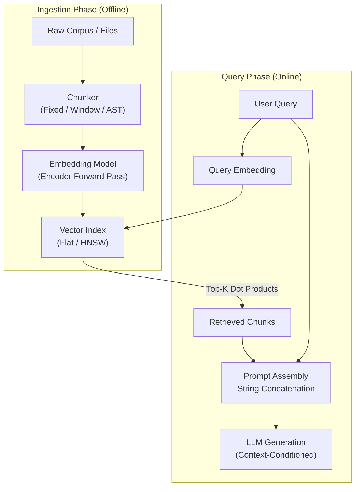

# Module 02: Retrieval & RAG

> Stripping away the "enterprise intelligence platform" illusion: the skeleton of RAG is string concatenation preceded by a similarity filter. Everything that makes it *good* (retrieval quality, context selection, sources, grounding) is ordinary engineering on top of that skeleton.

---

## Visual Mental Models

### 1. The Naive RAG Pipeline

Before dissecting the mechanics, observe how documents flow from raw disk files into the prompt:

```
+---------------------------------------------------------------------------------------------------------+
|                                    NAIVE RAG PIPELINE DATA FLOW                                         |
+---------------------------------------------------------------------------------------------------------+
|  [Raw Document]       "Database Connection Pool Settings: max_connections = 250 ..."                    |
|       |                                                                                                 |
|       v                                                                                                 |
|  [Chunker]            Slices text into arbitrary character/word blocks (e.g. 100 words, 20 overlap)     |
|       |                                                                                                 |
|       v                                                                                                 |
|  [Embedding Model]    Generates dense vector for each chunk: v_chunk = Embed(chunk_text)                |
|       |                                                                                                 |
|       v                                                                                                 |
|  [Vector Store]       Stores (chunk_id, v_chunk, metadata) in a matrix or index                         |
|                                                                                                         |
|  ........................................ QUERY TIME .................................................  |
|                                                                                                         |
|  [User Query]         "What is the maximum database connection limit?"                                  |
|       |                                                                                                 |
|       v                                                                                                 |
|  [Query Vector]       q_vec = Embed(query)                                                              |
|       |                                                                                                 |
|       v                                                                                                 |
|  [Similarity Filter]  Top-K Cosine Score = sort([dot_product(q_vec, v_i) for v_i in Store])[:K]         |
|       |                                                                                                 |
|       v                                                                                                 |
|  [Prompt Template]    "System: Answer using context.\nContext: {chunk_text}\nQuestion: {query}"         |
|       |                                                                                                 |
|       v                                                                                                 |
|  [LLM Completion]     Autoregressively generates text based on injected prompt context                  |
+---------------------------------------------------------------------------------------------------------+
```



---

### 2. The Query-Chunk Mismatch Problem

Why does semantic vector search often miss the right chunk? One reason: **questions do not look like answers in embedding space**.

```
Embedding Coordinate Space (2D Projection):

       ^ Axis Y (Semantic Topic: Relational Database Config)
       |
       |       [Chunk A] "Postgres max_connections = 250 to prevent exhaustion."
       |                 (Contains Answer: High factual density, declarative statement)
       |
       |       [Chunk B] "Database connection pool architecture overview and best practices."
       |                 (High thematic overlap, zero specific numbers)
       |
       |                 * [User Query] "What is the maximum database connection limit?"
       |                   (Interrogative sentence structure, low lexical overlap with Chunk A)
       |
       +--------------------------------------------------------> Axis X
```

When an embedding model encodes an interrogative sentence (*"How do I configure...?"*), it can land closer to general thematic overviews (*"Configuration Guide"*) than to the actual declarative fact (*"Set flag --max-conns=50"*), which pushes the answer below the `top_k` cutoff.

Common mitigations: embedding models trained for asymmetric search (separate "query" and "passage"
encodings), rewriting the query into the shape of an answer before embedding it, and a reranker that
re-scores the top candidates with the query and passage read together.

---

## 1. Chunking Strategies: Mechanics & Failure Modes

How you split text sets a ceiling on retrieval accuracy. No vector database or reranker can recover a fact that was cut in half during ingestion.

```
+----------------------------------------------------------------------------------------------------+
|                                      CHUNKING COMPARISON                                           |
+----------------------------------------------------------------------------------------------------+
| 1. NAIVE FIXED-SIZE:                                                                               |
| [def authenticate_admin(user_id: str, toke] | [n: str) -> bool:\n    if token == 'SE]              |
|                                               ^ Cut through identifier 'token' and variable        |
|----------------------------------------------------------------------------------------------------|
| 2. SLIDING WINDOW (WITH OVERLAP):                                                                  |
| [def authenticate_admin(user_id: str, token: str) -> bool:]                                        |
|                       [token: str) -> bool:\n    if token == 'SECRET':]                            |
|                       ^ Duplicates tokens across boundaries, inflating storage & token billing      |
|----------------------------------------------------------------------------------------------------|
| 3. STRUCTURAL / AST-AWARE:                                                                         |
| [def authenticate_admin(user_id: str, token: str) -> bool:\n    if token == 'SECRET':\n   return True] |
| ^ Respects complete syntactic unit (function boundary, Markdown section, or JSON record)          |
+----------------------------------------------------------------------------------------------------+
```

### Strategy 1: Fixed-Size Character / Token Slicing
- **The Mechanism:** Iterates through text in strides of $N$ characters (e.g. `text[i:i+N]`).
- **The Disaster:** Slices directly through words, UUIDs, function signatures, and sentences.
  - *Example:* `max_connections = 250` becomes `max_connectio` in Chunk 0 and `ns = 250` in Chunk 1.
  - Both chunks become useless for exact retrieval.

### Strategy 2: Sliding Window with Overlap
- **The Mechanism:** Slices blocks of size $N$ with an overlap of $M$ tokens (stride = $N - M$).
- **The Trade-Off:** Reduces truncation at boundaries, but duplicates content.
  - Every chunk repeats $M$ of its $N$ units, so the number of chunks (and vectors) grows by about $\frac{M}{N-M}$: $25\%$ for a $20\%$ overlap, $67\%$ for $40\%$.
  - Neighbouring chunks retrieved together repeat the same text in the prompt, which costs tokens and adds noise.

### Strategy 3: Structural / Delimiter / AST-Aware Slicing
- **The Mechanism:** Splits text along natural semantic boundaries:
  - For Markdown: `# Header 1`, `## Header 2`.
  - For Code: Python AST visitor splitting by `FunctionDef` or `ClassDef`.
  - For Prose: Paragraph breaks (`\n\n`) or sentence boundaries (a sentence splitter such as `nltk` or `spaCy`).
- **The Engineering Reality:** Structural chunking usually retrieves better because each chunk is an intact unit. It has its own failure mode: units vary wildly in size, so very long sections still need splitting and very short ones lack context.

*Proof of concept:* Run [`chunking_comparison.py`](chunking_comparison.py) to see naive chunking sever security exceptions while structural chunking keeps them intact.

---

## 2. Search Scaling Mechanics: Exact Flat vs. Approximate Nearest Neighbors (ANN)

When libraries advertise "billion-scale vector search", what algorithmic trade-offs are they actually making?

```
+---------------------------------------------------------------------------------------------+
|                                FLAT EXACT vs. HNSW GRAPH (ANN)                              |
+---------------------------------------------------------------------------------------------+
| FLAT SEARCH (Exact):                                                                        |
| Query [q] ----> dot(q, v_0)                                                                 |
|           ----> dot(q, v_1)   O(N * D) comparisons. Exhaustive scan.                        |
|           ----> dot(q, v_2)   Recall: 100% (Guaranteed exact global nearest neighbor).      |
|           ----> dot(q, v_N)                                                                 |
|---------------------------------------------------------------------------------------------|
| HNSW (Approximate Nearest Neighbor):                                                        |
| Layer 2 (Sparse):    (Node A) --------------> (Node Z)                                      |
|                         |                        |                                          |
| Layer 1 (Medium):    (Node A) -> (Node D) -> (Node Z)                                      |
|                         |           |            |                                          |
| Layer 0 (Dense):     (Node A)-(B)-(C)-(D)-(E)...(Z)                                        |
|                      About O(log N) comparisons via greedy multi-layer graph search.       |
|                      Recall below 100%, tunable (trades accuracy for throughput).          |
+---------------------------------------------------------------------------------------------+
```

### Exact Flat Search (Brute Force)
- Compares query vector $\mathbf{q}$ against all $N$ vectors in the corpus.
- **Time Complexity:** $\mathcal{O}(N \times D)$ where $D$ is embedding dimension.
- **Recall:** $100\%$ deterministic.
- **When to use:** Datasets up to roughly $100,000$ chunks, if you vectorize the math. With NumPy, $50,000$ dot products of dimension $1536$ are one matrix-vector product over a matrix of about $300\text{ MB}$ in float32; it is bound by memory bandwidth and takes tens of milliseconds (estimated, not measured here). In pure Python the same work takes seconds: we measured about $3\text{ s}$ on a laptop. Write the loop in Python to understand it, not to serve traffic.

### Approximate Nearest Neighbor (ANN / HNSW)
- **Hierarchical Navigable Small World (HNSW):** Constructs a multi-layer graph where upper layers have long-range links (fast coarse routing) and lower layers have dense short-range links (fine clustering), analogous to a probabilistic Skip-List.
- **Time Complexity:** roughly $\mathcal{O}(\log N)$ per query in practice.
- **Recall:** below $100\%$ and tunable. Larger graph degree (`M`) and search width (`ef_search`) raise recall at the cost of memory and latency; well-tuned indexes commonly reach the high 90s. It **can** miss true nearest neighbours, because the greedy search can stop in a local minimum. Measure recall against a flat index on your own data.
- **When to use:** Multi-million to billion-scale vector indexes.

---

## 3. The Naive RAG Fallacy: Why It Fails in Production

Naive RAG (Chunk $\rightarrow$ Embed $\rightarrow$ Top-K $\rightarrow$ Prompt Concatenation) is a classic prototype trap. Here is why it breaks down in production systems:

1. **Lost Structural Context:**  
   If a table cell containing `Sales: $4.2M` is separated from its column headers (`Region: EMEA, Year: 2025`), the retrieved chunk contains numbers without semantic meaning.
2. **Context Poisoning / Distractor Chunks:**  
   If `top_k = 5`, and 2 chunks contain the answer while 3 chunks contain superficially similar but outdated or irrelevant policies, the LLM can anchor on the wrong chunk or blend them into an answer that no source supports.
3. **Chunk Boundary Truncation:**  
   When a condition or negative modifier (*"Do NOT execute if..."*) is separated from the command by a chunk boundary, the RAG system retrieves the command without the safety check.

### What Production RAG Adds on Top of the Skeleton

The concatenation step stays trivial. The engineering lives around it:

| Problem | Typical technique |
| --- | --- |
| Retrieval quality | Hybrid search (BM25 + vectors), query rewriting, metadata filters, a reranker over the top candidates |
| Context selection | Deduplicate overlapping chunks, keep headers with table rows, cap the token budget, order by relevance |
| Provenance | Carry a source ID with every chunk and require the answer to cite it |
| Grounding | Check that each claim in the answer is supported by a retrieved chunk ([Module 06](../06-evals-and-benchmarking/README.md) measures this) |
| Freshness | Re-index on change and drop superseded documents |

---

## 4. When NOT to Use This (Architecture Waste & Anti-Patterns)

Before deploying a dedicated vector database (Pinecone, Weaviate, Milvus, Qdrant) and an embedding API, compute the architectural invoice.

```
+-----------------------------------------------------------------------------------------+
|                                THE LATENCY & COST BUDGET                                |
+-----------------------------------------------------------------------------------------+
| Architecture A: Vector Database RAG                                                     |
| 1. Ingestion: Embed 50,000 doc chunks via API (priced per token)                        |
| 2. Query Time: Client -> Embedding API HTTP POST (~120ms)                               |
| 3. Query Time: Client -> Vector DB network round trip (~35ms)                           |
| 4. Total Retrieval Latency: ~155ms - 250ms (illustrative)                               |
|                                                                                         |
| Architecture B: In-Memory BM25 / SQLite FTS5 (Boring Architecture)                      |
| 1. Ingestion: Pure text indexing into SQLite FTS5 virtual table (Local disk / RAM)      |
| 2. Query Time: `SELECT * FROM docs_fts WHERE docs_fts MATCH 'error AND timeout'`        |
| 3. Total Retrieval Latency: about 1ms (no network round trips, no API bills)            |
+-----------------------------------------------------------------------------------------+
```

### 1. Cost & Token Inflation
- **Embedding Ingestion Tax:** If your knowledge base updates frequently, you re-embed thousands of chunks on every sync.
- **Query Embedding Tax:** Every user keystroke or search invokes an embedding endpoint billing API credits.
- **Prompt Token Tax:** Stuffing 5 irrelevant 500-token chunks into every prompt costs 2,500 input tokens per query. At $100,000$ queries a month that is $250$ million wasted input tokens; multiply by your model's input price per million tokens.

### 2. The Deterministic Grep Alternative
If your codebase or document repository is in the tens of megabytes:
- `ripgrep` scans it in milliseconds to tens of milliseconds once the files are in the OS page cache.
- A structured file map (`git ls-files` plus an AST outline) and targeted lookups by an LLM or a script can often replace a vector database entirely. The companion repository [ai-context-mapping](https://github.com/umitkrkmz/ai-context-mapping) measured this kind of setup with real agents, including where a map did *not* save tokens.

---

## 5. Pragmatic Decision Matrix: Retrieval Alternatives

| Capability / Metric | `grep` / `ripgrep` | SQLite FTS5 (BM25) | Dense Vector RAG | Hybrid Search (BM25 + Dense) |
|---|---|---|---|---|
| **Query Latency** | $5\text{ ms} - 25\text{ ms}$ | **$0.4\text{ ms} - 2\text{ ms}$** | $100\text{ ms} - 250\text{ ms}$ | $100\text{ ms} - 260\text{ ms}$ |
| **Exact Identifiers (UUIDs, SKUs)** | **$100\%$ Precision** | **$100\%$ Precision** | Poor (returns near neighbours) | **High** (the BM25 side finds them) |
| **Semantic Paraphrasing** | Fails | Poor (requires synonyms) | **High** | **High** |
| **Infrastructure Complexity** | Zero (CLI binary) | Low (`sqlite3` is in the stdlib; FTS5 ships with most builds) | High (Vector DB, index sync) | Moderate-High |
| **Corpus Updates** | Instantaneous | Near-instantaneous (B-Tree/Inverted Index) | Slow (requires re-embedding) | Requires re-embedding vectors |
| **Storage Overhead** | $0\%$ (Reads raw files) | Small (an inverted index) | Large: $D \times 4$ bytes per chunk in float32 (6 KB at $D = 1536$), plus the ANN index | Medium-Large |

---

## 6. Runnable Code: Bare-Metal Naive RAG in Pure Python

Here is the naive RAG mechanism in standard Python: chunking, term-frequency vectors (a bag of words standing in for a learned embedding), exact flat similarity search, and prompt synthesis. No model is called; the point is the data flow.

```python
import math
import re

# 1. Document Chunking
def chunk_document(text: str, chunk_size_words: int = 20, overlap: int = 4) -> list[str]:
    words = text.split()
    chunks, start = [], 0
    while start < len(words):
        chunks.append(" ".join(words[start : start + chunk_size_words]))
        if start + chunk_size_words >= len(words):
            break
        start += max(1, chunk_size_words - overlap)
    return chunks

# 2. Bare-Metal Normalized Vector Generation
def embed(text: str, vocab: dict[str, int]) -> list[float]:
    tokens = re.findall(r"\b[a-z0-9_]+\b", text.lower())
    counts = {t: tokens.count(t) for t in tokens}
    vec = [counts.get(term, 0.0) for term in vocab]
    mag = math.sqrt(sum(x * x for x in vec))
    return [x / mag for x in vec] if mag > 0 else vec

# 3. Execution & Verification
corpus = (
    "Postgres Database Configuration: Under peak production load, max_connections = 250 "
    "to prevent OS process exhaustion. Connection timeout is set to 3000ms."
)
chunks = chunk_document(corpus, chunk_size_words=12, overlap=2)
vocab = {term: idx for idx, term in enumerate(sorted(set(re.findall(r"\b[a-z0-9_]+\b", corpus.lower()))))}

chunk_vectors = [embed(c, vocab) for c in chunks]

# Query
query = "What is max_connections under peak load?"
q_vec = embed(query, vocab)

# Flat Cosine Search (Dot product of normalized vectors)
scores = [sum(qi * vi for qi, vi in zip(q_vec, cv)) for cv in chunk_vectors]
best_idx = scores.index(max(scores))
best_chunk = chunks[best_idx]

# Prompt Synthesis
prompt = f"Context: {best_chunk}\nQuestion: {query}\nAnswer:"

# Assertion: Retrieval pulled the chunk with the exact answer
assert "max_connections = 250" in best_chunk
assert max(scores) > 0.0
print("Naive RAG assertion verified successfully.")
```

*Companion scripts:*
- Inspect [`naive_rag.py`](naive_rag.py) for the complete pipeline with TF-IDF weighting, prompt formatting, and a deterministic stand-in for the generation step (a regex, not an LLM).
- Inspect [`chunking_comparison.py`](chunking_comparison.py) for the concrete demonstration of boundary truncation bugs.

---

## Next Module

Proceed to [**Module 03: Context Engineering**](../03-context-engineering/README.md) to explore the "Lost in the Middle" phenomenon, the economics of Prompt Caching (read vs write arithmetic), and two-tier context architectures.
