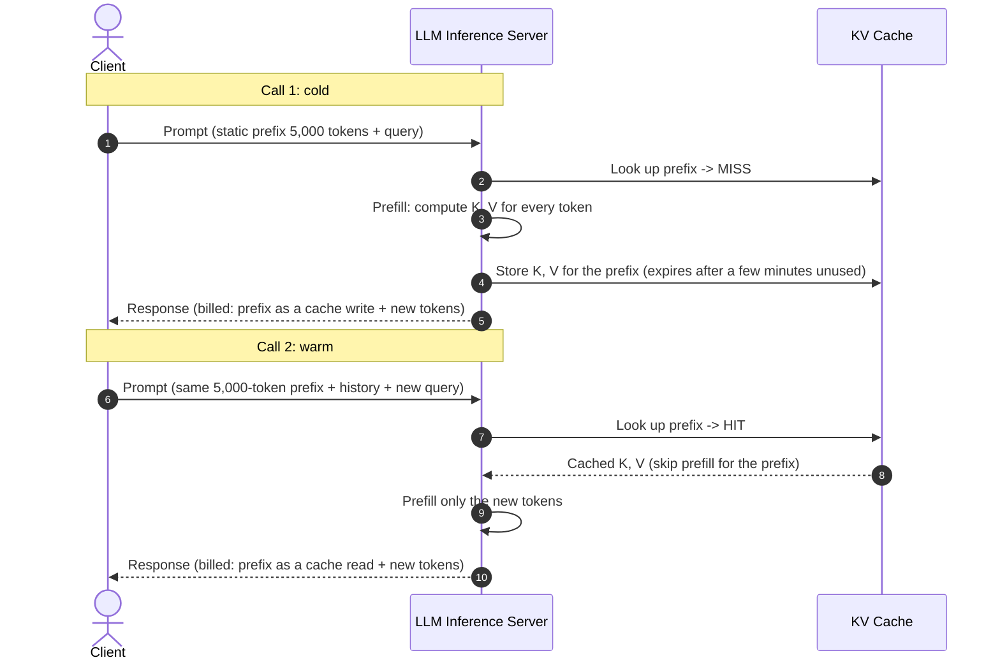

# Module 03: Context Engineering

> Stripping away the "infinite context" illusion: prompt caching is prefix matching, long contexts are not used evenly, and every token you add (a system prompt, a file the agent reads) is paid for on every later call.

---

## Visual Mental Models

### 1. Position Matters: "Lost in the Middle"

Liu et al. (2023), *Lost in the Middle: How Language Models Use Long Contexts* (TACL 2024), tested
multi-document question answering and key-value retrieval. The models they tested did best when the
relevant passage sat near the start or the end of the context, and worst when it sat in the middle:

```
  Accuracy                                  (schematic shape, not data)
     ^
     |  \                                                    /
     |   \                                                  /
     |    \                                                /
     |     \______________________________________________/
     |
     +--------------------------------------------------------->  position of the relevant passage
       start                    middle                     end
```

Three things the picture does not say:

- **How deep the dip is.** It depends on the model, the task and the context length. Later long-context
  models show it less, and needle tests that look for one literal fact are easier than reasoning over
  several passages.
- **Why.** The paper measures accuracy, not attention weights.
- **Where the "middle" starts.** There is no universal 15% / 85% boundary.

So treat position as something to **measure on your model**. [`context_position_tester.py`](context_position_tester.py)
builds that test: it places a fact at chosen positions and runs any model you plug in.

---

### 2. Prompt Caching Anatomy: Prefix Matching Mechanics

Prompt caching is not memory of the conversation. During the prefill phase, every layer computes **key
and value tensors** ($K$, $V$) for every prompt token. Caching keeps those tensors for a prompt prefix, so
a later request that starts with *exactly the same tokens* skips recomputing them.

```
+---------------------------------------------------------------------------------------------------------+
|                                    PROMPT CACHE PREFIX ANATOMY                                          |
+---------------------------------------------------------------------------------------------------------+
| Call 1 (cold):                                                                                          |
| [Static System Rules (2,000 tokens)] [API Schema (3,000 tokens)] [Turn 1 Query (100)]                  |
| |<---------------------- written to cache --------------------->| [normal input]                        |
|                                                                                                         |
| Call 2 (warm):                                                                                          |
| [Static System Rules (2,000 tokens)] [API Schema (3,000 tokens)] [Turn 1 Q&A (400)] [Turn 2 Query (100)]|
| |<---------------------- read from cache ---------------------->| [normal input, or written to cache]   |
|                                                                                                         |
| CACHE INVALIDATION HAZARD:                                                                              |
| Put anything that changes per request (a timestamp, a session ID) in front of the static text:         |
| [Timestamp: 10:45:01] [Static System Rules] [API Schema]                                                |
| ^ The prefix no longer matches, so nothing after it can be read from cache.                             |
+---------------------------------------------------------------------------------------------------------+
```

Providers differ in the details, so check yours:

- **How caching is triggered.** Some cache automatically above a minimum prompt length; others cache only
  at breakpoints you mark.
- **How it is priced.** Some charge a surcharge to write and a steep discount to read. Others only discount
  reads.
- **How long an entry lives.** Unused entries expire after minutes; some providers offer longer TTLs.

This module's examples use one published price shape: **writes at $1.25\times$ the input price, reads at
$0.10\times$**.



---

### 3. Bloated Instructions vs. Two-Tier Navigation

A common mistake is to put twenty pages of instructions, rules, coding styles and project history into one
giant `CLAUDE.md` or system prompt. Rules contradict each other, and the important ones are diluted by the
unimportant ones.

```
+----------------------------------------------------------------------------------------------------+
|                                    TWO-TIER CONTEXT ARCHITECTURE                                   |
+----------------------------------------------------------------------------------------------------+
| ANTI-PATTERN: The Monolith (5,000 - 30,000 lines)                                                  |
| [System Prompt: Full Repo Docs + Coding Standards + API Schemas + DB DDL + Examples]              |
| -> Large input on every call (cheap only while it stays cached)                                    |
| -> Contradictory rules, important ones lost among unimportant ones                                 |
|----------------------------------------------------------------------------------------------------|
| TWO-TIER PATTERN: Manifesto + On-Demand Targeted Lookups                                           |
| Tier 0: Static Core Manifesto (lean, ~100-150 lines, cached)                                      |
|         - Mission, negative invariants ("never do X", and what stays allowed), a file index.      |
| Tier 1: On-demand reads (file/tool lookups only when needed)                                       |
|         - The agent reads `schema.sql` only when it modifies database queries.                     |
|         - Every read is a tool call: one more model call, and the result stays in the history.    |
+----------------------------------------------------------------------------------------------------+
```

The two-tier pattern trades **prompt size** for **tool calls**. Section 2 shows when that trade wins and
when it loses.

---

## 1. The Infinite Context Illusion

Some models accept context windows of a million tokens or more. That invites the idea: *"Never chunk or
search again; put the whole repository in the prompt."* It has three costs.

### 1. Prefill Latency (Time-To-First-Token)
Before a model emits its first token, it must process the whole prompt (the *prefill* phase). Prefill time
grows with prompt length, faster than linearly for long prompts because of attention. Hundreds of tokens
prefill in well under a second; hundreds of thousands can take tens of seconds. Prompt caching removes this
cost only for the cached prefix. Measure time-to-first-token on your provider before you design around it.

### 2. Quadratic Attention Compute ($\mathcal{O}(L^2)$)
Standard self-attention compares every token with every other token:
$$\text{Attention}(Q, K, V) = \text{softmax}\left(\frac{QK^T}{\sqrt{d_k}}\right)V$$
A $10\times$ longer prompt means about $100\times$ more attention compute. FlashAttention makes this much
faster and avoids materializing the $L \times L$ matrix, but the arithmetic stays quadratic. (Sub-quadratic
"linear attention" variants exist; they change the architecture, not just the implementation.)

### 3. Context Pollution in Long Sessions
In a 20-turn session that keeps every failed tool call, stack trace and verbose turn, the model can start
to anchor on its own earlier mistakes. The useful signal gets a smaller share of the prompt with every
turn. Trimming or summarizing old history is part of context engineering.

---

## 2. Multi-Turn Cost Arithmetic

Suppose:
- Static system prompt: $S$ tokens
- User query per turn: $U$ tokens
- Assistant response per turn: $A$ tokens

Every call re-sends the whole conversation. On turn $t$ the input is:
$$\text{Input}(t) = S + (t - 1)(U + A) + U$$

Across $T$ turns:
$$\text{Total Input Tokens} = \sum_{t=1}^T [S + (t - 1)(U + A) + U] = T \cdot S + T \cdot U + \frac{T(T - 1)}{2}(U + A)$$

The $\frac{T(T - 1)}{2}(U + A)$ term is quadratic: twice the turns, about four times the history tokens.

### Three Caching Policies

| Policy | What is read from cache | What is paid in full |
| --- | --- | --- |
| **None** | nothing | every token of every call |
| **Static prefix** | the system prompt $S$ (from call 2 on) | the whole history, every call |
| **Incremental** | everything already sent in the previous call | only the new tokens (written to cache) |

Agent tools commonly use the incremental policy, which turns the quadratic history from full price into
cache-read price. The tokens are still sent and still processed; they are just billed differently.

### Tool Reads Are Context Too

In an agent, a file read is a tool call. The model emits the call, the result joins the history, and the
model is called again with everything so far. One read per turn doubles the number of model calls; three
reads per turn quadruple it. With the example prices and 12 user turns
([`kv_cache_calculator.py`](kv_cache_calculator.py)):

```
Scenario                                  calls   input tokens   cost
Monolith 30k, no cache                       12        394,800   $1.2474
Monolith 30k, static-prefix cache            12        394,800   $0.3789
Monolith 30k, incremental cache              12        394,800   $0.3044
Two-tier 1.5k, no reads                      12         52,800   $0.1035
Two-tier 1.5k, 1 read of 2k per turn         24        402,240   $0.3044
Two-tier 1.5k, 3 reads of 2k per turn        48      1,991,040   $0.9732

Caching a 30k static prefix pays for its write surcharge on turn 2.
```

The lean prompt wins by about $3\times$ when the agent reads nothing. With one 2k read per turn it breaks
even with a cached monolith. With three reads per turn it costs about $3\times$ *more*. The saving lives in
reading less, not in a smaller system prompt.

**Measured with real agents.** The companion repository
[ai-context-mapping](https://github.com/umitkrkmz/ai-context-mapping) ran this comparison with Claude Code
on a 55,600-token project and a bug that one `grep` finds. A two-tier setup (manifesto, project map,
invariants, on-demand reads) cost a **median 38% more** than the bare project, with the same fix. The
agents read the map and the rules and ran checks, so they made more calls
([experiment 5](https://github.com/umitkrkmz/ai-context-mapping/blob/main/docs/benchmark-results.md#13-experiment-5-the-framework-as-an-adopter-runs-it-v120)).
The same project's experiments 6 and 7 show what the extra context *does* buy: protection against a
harmful change, discussed in [Module 05](../05-agent-guardrails/README.md).

> Context reduction is not inherently good. The goal is targeted context, not less context.

---

## 3. When NOT to Use This (Architecture Waste & Anti-Patterns)

### Anti-Pattern 1: Prepending Dynamic Timestamps or Session IDs
If you construct your prompt like this:

<!-- verify_all: illustrative fragment, not executed -->
```python
# DISASTER: Invalidates prompt cache on every single request
prompt = f"Current Time: {datetime.now().isoformat()}\nUser: {user_id}\n\n{STATIC_SYSTEM_RULES}"
```
caching matches the token prefix from the first token, so a changing timestamp at the front **misses
the cache on every request**. Every call then pays to process (and, where writes cost extra, to write)
the whole static block again.

**The Fix:** Put static text first. Append what changes per request (timestamps, session IDs, user input)
at the end:

<!-- verify_all: illustrative fragment, not executed -->
```python
# CORRECT: The static prefix is identical on every request
prompt = f"{STATIC_SYSTEM_RULES}\n\nCurrent Time: {datetime.now().isoformat()}\nUser: {user_id}"
```

### Anti-Pattern 2: Burying Critical Rules in a Long Document
A critical constraint (*"NEVER drop production database tables without user confirmation"*) at line 3,200
of a 5,000-line instruction file competes with everything around it, and it may sit in the middle of the
context.

**The Fix:** Put critical rules in the short Tier 0 manifesto, and, for long prompts, repeat them right
before the user's request. Write each rule so that it also says **what stays allowed**. In the
ai-context-mapping experiments, a rule that only listed what was forbidden made every agent stop and ask.
One sentence about what remained allowed let them do the safe work.

---

## 4. Decision Matrix: Context Architectures Compared

| Architecture | Input per call | Model calls | Maintenance burden | Failure mode |
|---|---|---|---|---|
| **Mega-prompt (full dump)** | Very large; cheap only while cached | Fewest | Low (copy files in) | Diluted rules, slow prefill, stale copies |
| **Naive RAG** | Small | Few | High (chunking, index, sync) | Missing or severed chunks |
| **Two-tier navigation** | Small static part plus what the agent reads | One more per read | Low (a file map that must stay current) | Many reads cost more than the monolith; a stale map misleads |

---

## 5. Copy-Paste Runnable: The Quadratic History and What Caching Does to It

```python
U, A, S, T = 150, 350, 30_000, 12           # tokens per query, per answer, static prompt; turns
BASE, WRITE, READ = 3.00, 3.75, 0.30        # example USD per 1M input tokens

def input_tokens(t: int) -> int:            # tokens sent on turn t (1-based), no tool calls
    return S + (t - 1) * (U + A) + U

total = sum(input_tokens(t) for t in range(1, T + 1))
assert total == T * S + T * U + T * (T - 1) // 2 * (U + A)       # the closed form holds

no_cache = total * BASE / 1e6
# Incremental caching: call t reads what call t-1 sent and writes only the new tokens.
incremental = sum(
    ((input_tokens(t - 1) if t > 1 else 0) * READ + (input_tokens(t) - (input_tokens(t - 1) if t > 1 else 0)) * WRITE) / 1e6
    for t in range(1, T + 1)
)
assert incremental < no_cache / 4           # same tokens, about a fifth of the input bill
print(f"input tokens: {total:,} | no cache: ${no_cache:.4f} | incremental cache: ${incremental:.4f} (input only)")
```

*Companion scripts:*
- [`kv_cache_calculator.py`](kv_cache_calculator.py): the three caching policies and tool reads, with the scenario table above.
- [`context_position_tester.py`](context_position_tester.py): a needle-in-a-haystack position sweep you can run against your own model.

---

## Next Module

Proceed to [**Module 04: Tools & MCP**](../04-tools-and-mcp/README.md) to see how LLM function calling actually works (JSON Schema in, tool-use loops out) and to build a minimal stdio MCP server in standard Python.
