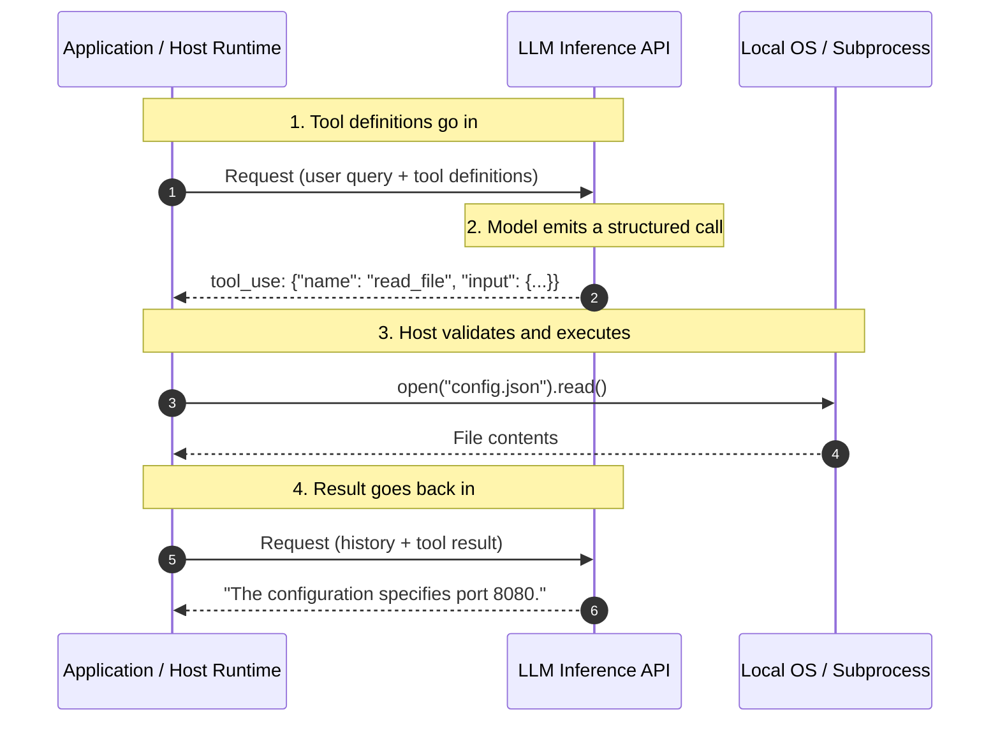
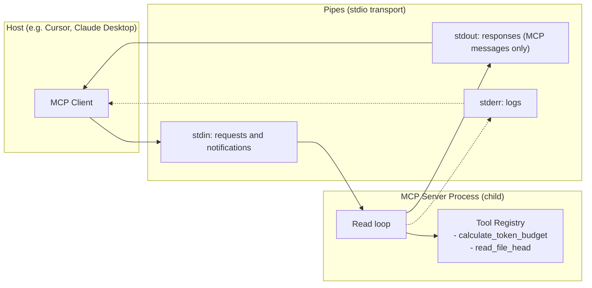

# Module 04: Tools & MCP

> Stripping away the "agent tool mastery" illusion: the model never executes code; it emits structured text that your program executes. MCP is JSON-RPC 2.0 messages over a transport (stdio pipes or HTTP), plus a lifecycle and a few conventions.

---

## Visual Mental Models

### 1. Anatomy of LLM Function Calling

A common misconception is that a large language model has a runtime that can invoke Python functions or
make network requests by itself.

**It does not.**

Function calling is a loop of text generation and parsing, run by the host program:

```
+---------------------------------------------------------------------------------------------------------+
|                                    FUNCTION CALLING EXECUTION LOOP                                      |
+---------------------------------------------------------------------------------------------------------+
|  1. SCHEMA INJECTION                                                                                    |
|     The tool definitions (name, description, JSON Schema of the arguments) go into the model's input:   |
|     "You have access to tool 'restart_server(server_id: str)'..."                                       |
|                                                                                                         |
|  2. STRING PREDICTION                                                                                   |
|     The model generates text that encodes a call:                                                       |
|     `<tool_call>{"name": "restart_server", "arguments": {"server_id": "srv_42"}}</tool_call>`           |
|                                                                                                         |
|  3. STOP AND PARSE                                                                                      |
|     Generation stops at the end of the call; the call is parsed into a name and arguments.              |
|                                                                                                         |
|  4. LOCAL HOST EXECUTION                                                                                |
|     The host (your Python or Node program) validates the arguments and runs the ACTUAL function:        |
|     `result = subprocess.run(["systemctl", "restart", "srv_42"])`                                       |
|                                                                                                         |
|  5. RESULT FEEDBACK                                                                                     |
|     The host appends the result to the conversation as a tool-result message.                           |
|                                                                                                         |
|  6. NEXT GENERATION                                                                                     |
|     The model is called again with the result in its input, and continues: another call, or an answer.  |
+---------------------------------------------------------------------------------------------------------+
```

With a hosted model API you do not write the tags or the stop logic. You pass the tool definitions as a
`tools` parameter and receive structured tool-use blocks back. The provider formats the definitions into
the model's input with special tokens, the model is trained to emit calls in that format, and the API parses
them for you. Some providers also constrain generation so arguments match the schema. The loop above is
still what happens. "Server-side" tools a provider offers (search, code execution) are run by the
provider's infrastructure; the model still only emits the call.



---

### 2. Model Context Protocol (MCP) Architecture

The **Model Context Protocol (MCP)**, published by Anthropic in November 2024, standardizes how an AI
application (the **host**) connects to external capabilities (**servers**). It does not replace the
model's own tool-calling format. The host asks MCP servers which tools they offer, translates those
definitions into whatever format its model API uses, and forwards the model's calls back to the server.
What MCP standardizes is the server side: one server works with every host that speaks the protocol.

Messages are **JSON-RPC 2.0**, UTF-8 encoded. The 2025-06-18 specification defines two standard
transports:

- **stdio**: the host starts the server as a child process and talks over its stdin and stdout.
- **Streamable HTTP**: the server is an independent HTTP endpoint that can serve many clients. It replaced
  the older HTTP+SSE transport.

```
+---------------------------------------------------------------------------------------------+
|                                MCP ARCHITECTURE (stdio)                                     |
+---------------------------------------------------------------------------------------------+
|  [Host Application]                                                                         |
|  (Claude Desktop, Cursor, a custom agent backend)                                           |
|        |                                                                                    |
|        v                                                                                    |
|  [MCP Client]  one per server connection                                                    |
|  Starts the server as a child process and owns its stdin/stdout pipes                       |
|        |                                                                                    |
|        |--- JSON-RPC 2.0 messages on the server's stdin ------------------------------->   |
|        |                                                                               |    |
|        |<-- JSON-RPC 2.0 messages on the server's stdout ------------------------------+    |
|                                                                                        v    |
|                                                                             [MCP Server]    |
|                                                                             - Tools         |
|                                                                             - Resources     |
|                                                                             - Prompts       |
+---------------------------------------------------------------------------------------------+
```

The stdio rules are strict, and breaking them is the most common bug in a hand-written server:

- One message per line. A message **must not** contain an embedded newline.
- The server **must not** write anything to stdout that is not a valid MCP message. A stray `print()`
  corrupts the stream.
- Logs go to **stderr**. The client may show them, forward them or ignore them.



Servers can offer **tools** (functions the model may call), **resources** (data the host can read) and
**prompts** (templates). Clients can offer **roots** (directories the server may work in), **sampling**
(the server asks the host's model for a completion) and **elicitation** (the server asks the user for
input). Each side declares what it supports during initialization.

---

### 3. The MCP Lifecycle

```
+----------------------------------------------------------------------------------------------------+
|                                    THE MCP LIFECYCLE (2025-06-18)                                  |
+----------------------------------------------------------------------------------------------------+
| 1. INITIALIZATION                                                                                  |
|    Client -> Server: {"jsonrpc":"2.0","id":1,"method":"initialize",                                |
|                       "params":{"protocolVersion":"2025-06-18","capabilities":{...},"clientInfo":...}}|
|    Server -> Client: {"jsonrpc":"2.0","id":1,"result":{"protocolVersion":"2025-06-18",              |
|                       "capabilities":{"tools":{...}},"serverInfo":...}}                            |
|      - Version negotiation: the server echoes the client's version if it supports it, otherwise    |
|        offers its own newest version; a client that cannot accept that should disconnect.          |
|      - Capability negotiation: each side declares the optional features it supports.               |
|    Client -> Server: {"jsonrpc":"2.0","method":"notifications/initialized"}   (a notification)     |
|                                                                                                    |
| 2. OPERATION  (only negotiated capabilities may be used)                                           |
|    tools/list  -> {"tools": [definition, ...]}                                                      |
|    tools/call  -> {"content": [{"type": "text", ...}], "isError": false}                            |
|    ping        -> {}                                                                                |
|                                                                                                    |
| 3. SHUTDOWN (stdio)                                                                                |
|    The client closes the server's stdin and waits for it to exit (then SIGTERM, then SIGKILL).     |
+----------------------------------------------------------------------------------------------------+
```

**Two kinds of errors.** A problem with the request itself (unknown tool, invalid arguments, a server
fault) is a JSON-RPC error with a code. A failure while the tool runs (the API it calls is down, the file
is missing) is a normal result with `"isError": true`, so the model can read what went wrong and react.

| Code | Meaning |
| --- | --- |
| -32700 | Parse error (the line is not valid JSON) |
| -32600 | Invalid request (not a JSON-RPC 2.0 request object) |
| -32601 | Method not found |
| -32602 | Invalid params (MCP also uses it for an unknown tool name) |
| -32603 | Internal error |

A **request** carries an `id` and always gets exactly one response. A **notification** has no `id` and
never gets one.

---

## 1. The Illusion of "Tool Mastery"

Adding tools is not free. Too many tools, or overlapping ones, make tool selection worse.

### 1. Schema Token Overhead
Every tool definition carries a name, a description, and a JSON Schema for its parameters. A
medium-complexity definition is a few hundred tokens:
- 40 tools at 200 to 500 tokens each is **8,000 to 20,000 tokens** in every request.
- Prompt caching makes repeated definitions cheap to *bill*, but they still occupy the context and compete
  for the model's attention.
- Some hosts load definitions on demand: the model first sees only tool names and fetches a full schema
  when it needs one.

### 2. Routing Ambiguity and Invalid Arguments
When tools have overlapping descriptions (`search_code`, `query_repository`, `find_symbol`), the model
picks the wrong one more often. It can also send arguments of the wrong shape, or retry a failing call in
a loop. Fewer, clearly separated tools with strict schemas help, and so does validating arguments on the
server, which the MCP specification requires.

---

## 2. Security: Tools Are an Attack Surface

The MCP specification lists what each side must do. **Servers must** validate all tool inputs, implement
access control, rate-limit invocations, and sanitize outputs. **Clients should** ask the user to confirm
sensitive operations, show tool inputs before calling the server, validate tool results before passing
them to the model, set timeouts, and log tool use. Behind those rules:

- **A local stdio server runs with your user account's permissions.** "Scoped methods" do not sandbox it.
  A file-reading tool can read any file you can, unless the server restricts it. The companion server
  confines `read_file_head` to one root directory.
- **Tool results are untrusted input.** A web page, an email or a file the tool returns can contain text
  written to steer the model ("ignore your instructions and..."). This is prompt injection.
- **Tool descriptions and annotations are untrusted** unless the server is. A malicious server can
  describe a tool misleadingly.
- **Keep a human in the loop for side effects.** The specification recommends that a person can see and
  deny tool calls.

---

## 3. When NOT to Use This (Architecture Waste & Anti-Patterns)

### Anti-Pattern 1: The "Raw API Dump" Context Blowout
A tool queries an external API and returns the entire raw payload to the model. (Illustrative fragment:
`requests` and `@tool` come from your HTTP library and agent framework.)

<!-- verify_all: illustrative fragment, not executed -->
```python
# DISASTER: returns the whole raw payload to the model
@tool
def get_user_activity(user_id: str):
    raw_response = requests.get(f"https://api.example.com/users/{user_id}/logs")
    return raw_response.text  # tens of thousands of lines of JSON
```

**The cost**, at roughly 4 characters per token:
1. An 800 KB payload is about $200,000$ tokens, more than many context windows hold.
2. At $3 per million input tokens that is $0.60 for one call, paid again on every later call that re-sends it.
3. The instructions and rules now make up a tiny share of the context.

**The Fix (filter in code before the model sees it):**

<!-- verify_all: illustrative fragment, not executed -->
```python
# CORRECT: compute what the model needs in deterministic code
@tool
def get_user_activity(user_id: str):
    logs = requests.get(f"https://api.example.com/users/{user_id}/logs").json()
    return {
        "user_id": user_id,
        "failed_logins_24h": sum(1 for log in logs if log["status"] == 401),
        "last_ip": logs[-1]["ip"] if logs else None,
        "active_session": logs[-1]["is_active"] if logs else False,
    }  # a few dozen tokens
```

### Anti-Pattern 2: Turning Simple Scripts into MCP Servers
If a command or script (`python migrate.py --dry-run`) can run deterministically without a model deciding
anything, wrapping it in an MCP tool adds a process, serialization and a model decision in front of it,
and none of them is needed.

---

## 4. Decision Matrix: Tool Execution Patterns

| Dimension | Direct Bash / CLI Execution | MCP Server (stdio) | In-Code Function Calling |
|---|---|---|---|
| **Protocol Overhead** | None (exit codes and text) | Low (JSON-RPC serialization) | None (in-memory calls) |
| **Reuse Across Hosts** | Per tool | **Broad** (any MCP host) | Tied to one application |
| **Security** | Whatever the shell can do | Only as safe as the server: a local server has your permissions | Whatever your application allows |
| **Context Overhead** | Low (help text on demand) | Medium (definitions sent up front, or loaded on demand) | Medium (definitions sent up front) |
| **Ideal Use Case** | Local developer utilities | Capabilities shared by editors and agents | One application's own agent backend |

---

## 5. Copy-Paste Runnable: A JSON-RPC 2.0 Dispatcher

The core of a server's read loop, including the parts that are easy to get wrong: notifications get no
reply, malformed JSON gets -32700, bad arguments get -32602, and a crash inside a method still gets an answer.

```python
import json

def dispatch_rpc(raw_line: str, registry: dict):
    """Return the response line for one request, or None for a notification."""
    try:
        req = json.loads(raw_line)
    except json.JSONDecodeError:
        return json.dumps({"jsonrpc": "2.0", "id": None, "error": {"code": -32700, "message": "Parse error"}})
    if not isinstance(req, dict) or req.get("jsonrpc") != "2.0" or not isinstance(req.get("method"), str):
        return json.dumps({"jsonrpc": "2.0", "id": None, "error": {"code": -32600, "message": "Invalid Request"}})
    if "id" not in req:
        return None                                   # a notification: never answered
    req_id, method, params = req["id"], req["method"], req.get("params", {})

    def error(code: int, message: str) -> str:
        return json.dumps({"jsonrpc": "2.0", "id": req_id, "error": {"code": code, "message": message}})

    if method not in registry:
        return error(-32601, f"Method not found: {method}")
    try:
        return json.dumps({"jsonrpc": "2.0", "id": req_id, "result": registry[method](**params)})
    except TypeError as exc:                          # wrong or missing arguments
        return error(-32602, f"Invalid params: {exc}")
    except Exception:                                 # a fault inside the method
        return error(-32603, "Internal error")

# --- VERIFICATION ---
tools = {"ping": lambda: {}, "add": lambda a, b: a + b, "boom": lambda: 1 / 0}
call = lambda line: json.loads(dispatch_rpc(line, tools))

assert call('{"jsonrpc": "2.0", "id": 1, "method": "ping"}')["result"] == {}
assert call('{"jsonrpc": "2.0", "id": 2, "method": "add", "params": {"a": 10, "b": 32}}')["result"] == 42
assert call('{"jsonrpc": "2.0", "id": 3, "method": "destroy_world"}')["error"]["code"] == -32601
assert call('{"jsonrpc": "2.0", "id": 4, "method": "add", "params": {"a": 1}}')["error"]["code"] == -32602
assert call('{"jsonrpc": "2.0", "id": 5, "method": "boom"}')["error"]["code"] == -32603
assert call('{not json')["error"]["code"] == -32700
assert dispatch_rpc('{"jsonrpc": "2.0", "method": "notifications/initialized"}', tools) is None
print("JSON-RPC 2.0 dispatcher contract verified.")
```

*Companion scripts:*
- [`minimal_mcp_server.py`](minimal_mcp_server.py): a minimal stdio MCP server that follows the 2025-06-18
  specification for what it implements (lifecycle, version negotiation, tools, ping, the error contract,
  a root-confined file tool). It has no asserts of its own; the tester below exercises it over real pipes.
- [`mcp_client_tester.py`](mcp_client_tester.py): a client that starts the server, runs the lifecycle,
  checks every error path, and shuts it down the way the specification describes.
- For a production-shaped example with real tools, see the companion repository's
  [context server](https://github.com/umitkrkmz/ai-context-mapping/blob/main/mcp/context_server.py).

---

## Next Module

Proceed to [**Module 05: Agent Guardrails**](../05-agent-guardrails/README.md) to explore the mechanics and failure loops of the ReAct pattern (`Thought -> Action -> Observation`), the limits of "LLM-as-a-Judge", and deterministic AST boundary checkers.
