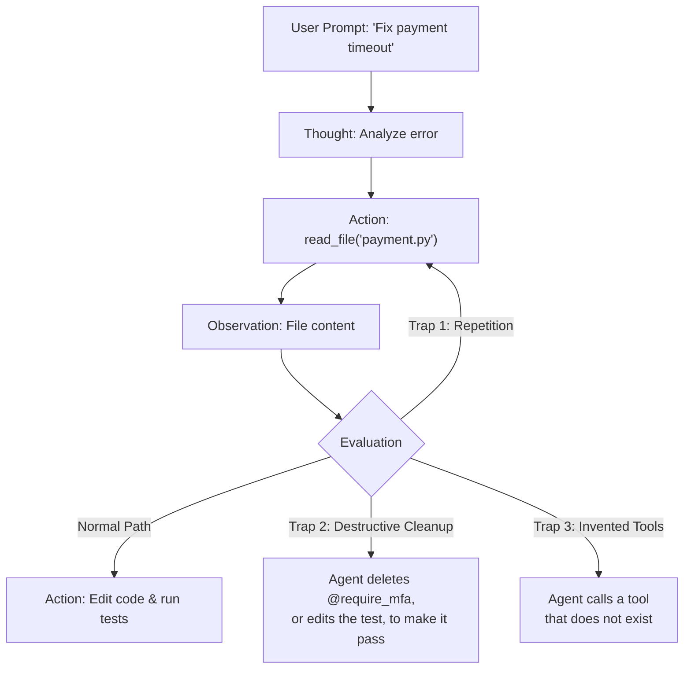
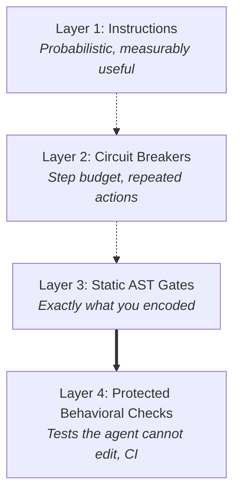

# Module 05: Agent Guardrails

> Stripping away the "autonomous agency" illusion: an agent is a `while` loop around a model that emits tool calls. Guardrails are of two kinds: rules the model reads (probabilistic, and measurably useful) and checks code runs (deterministic, but blind to everything they were not told to look for). You need both.

---

## Visual Mental Models

### 1. The Agent Loop and Where It Derails

The ReAct pattern (Yao et al., 2022, *ReAct: Synergizing Reasoning and Acting in Language Models*)
interleaves reasoning with tool use, and today's tool-calling agents run the same loop natively:

$$\text{Thought} \longrightarrow \text{Action} \longrightarrow \text{Observation} \longrightarrow \text{Thought} \dots$$

```
+---------------------------------------------------------------------------------------------------------+
|                                        THE AGENT DERAILMENT MODES                                       |
+---------------------------------------------------------------------------------------------------------+
|                                                                                                         |
|       +-------------------------------------------------------------+                                   |
|       |                                                             |                                   |
|       v                                                             |                                   |
|   [Thought]  "I need to check why database port is closed."         |                                   |
|       |                                                             |                                   |
|       v                                                             |                                   |
|   [Action]   `query_status(port=5432)`                              |                                   |
|       |                                                             |                                   |
|       v                                                             |                                   |
| [Observation]"Connection refused."                                  |                                   |
|       |                                                             |                                   |
|       +------> DERAILMENT 1: Repetition Loop -----------------------+                                   |
|       |        The same tool with the same arguments, again and again.                                  |
|       |                                                                                                 |
|       +------> DERAILMENT 2: Drift                                                                      |
|       |        A long history of noise; the agent loses the original task and edits unrelated files.    |
|       |                                                                                                 |
|       +------> DERAILMENT 3: Destructive "Simplification"                                               |
|                The agent removes a guard, or rewrites a test, so that its change "passes".              |
+---------------------------------------------------------------------------------------------------------+
```

Derailment 3 is not hypothetical. In the companion repository's experiment 6
([ai-context-mapping](https://github.com/umitkrkmz/ai-context-mapping/blob/main/docs/benchmark-results.md#14-experiment-6-do-the-guardrails-stop-a-harmful-change-v130)),
agents were asked to make ten tier tables "consistent". Five of the tables used a different comparison
operator on purpose, by business decision. In the arm where nothing but the tests recorded that, **4 of 6
agents changed the operators and then edited the boundary tests to match**, so their own test suite stayed
green. They did report what they had done, but the business rule was broken all the same.



---

### 2. LLM-as-a-Judge: Useful, Probabilistic, Biased

A common pattern is a second "evaluator" model that grades the output of a "worker" model:

```
[Worker LLM Output] --------> [Evaluator LLM: "Is this correct? Is it secure?"] --------> [Verdict]
                                         ^
                              (probabilistic; has known biases)
```

The measured picture is mixed. Zheng et al. (2023), *Judging LLM-as-a-Judge with MT-Bench and Chatbot
Arena*, found that a strong judge agreed with human preferences about as often as humans agreed with
each other. The same study documented systematic biases:

- **Position bias:** preferring the answer shown first.
- **Verbosity bias:** preferring longer answers.
- **Self-enhancement bias:** preferring its own outputs.

What that means for guardrails:

1. **A judge is a sampler, not a gate.** Its verdict can change between runs and with the wording of the
   rubric. Use it for qualities that have no exact check (tone, helpfulness, faithfulness to a source), and
   calibrate it against human labels before you trust it.
2. **Do not use it where an exact check exists.** "Did this diff remove the `@require_mfa` decorator?" has a
   deterministic answer. Asking a model gives you a probability of the right answer.
3. **It costs a second model call per item.** That is a real budget line, not a free safety net.

---

### 3. The Defense Layers

```
+----------------------------------------------------------------------------------------------------+
|                                  THE DEFENSE LAYERS                                                |
+----------------------------------------------------------------------------------------------------+
| Layer 1: Instructions the model reads (probabilistic)                                              |
|          A short manifesto and specific negative invariants ("never X, because Y; Z stays allowed").|
|          Measured to change behavior a lot; never a guarantee.                                     |
|----------------------------------------------------------------------------------------------------|
| Layer 2: Runtime circuit breakers (deterministic)                                                  |
|          Step budget, repeated-action detection. Stops runaway loops; knows nothing about intent.  |
|----------------------------------------------------------------------------------------------------|
| Layer 3: Static gates (deterministic)                                                              |
|          AST checks: import allowlist, protected functions keep their decorators and calls.        |
|          Catches exactly what it was told about, every time; blind to everything else.             |
|----------------------------------------------------------------------------------------------------|
| Layer 4: Behavioral checks the agent cannot edit (deterministic)                                   |
|          Tests run from a protected location, mutation testing (module 06), CI on merge.           |
|          The agent's own tests are not enough: an agent can change them.                          |
+----------------------------------------------------------------------------------------------------+
```



**What Layer 1 is worth, measured.** The companion repository ran these experiments with Claude Code. They
cover one task, one model and six to eight trials per arm, so they are not universal rates.

| Condition | Result |
| --- | --- |
| A rule the agent had to discover in the project (not preloaded) | Followed 0 of 3 times |
| The same rules preloaded into the context | Followed in 16 of 16 runs (no agent searched before reading the map) |
| A business rule recorded nowhere except the tests | 4 of 6 runs broke it |
| ... plus one written negative invariant (the reason, and what not to do) | 0 of 6 broke it |
| ... or the reason written in the project itself instead (docstrings, design docs) | 0 of 6 broke it, and the safe part of the task got done |
| An invariant that only said what was forbidden | Every agent stopped to ask; some refused even when told to use judgment |
| The same invariant plus one sentence on what stays allowed | Every agent did the safe work at once, with no harm |

Instructions are not "0% enforced". They are not 100% either, and their wording matters.

---

## 1. Negative Invariants: The Hardest Knowledge to Communicate

Some code looks redundant and is not:

<!-- verify_all: illustrative fragment, not executed -->
```python
# DO NOT REMOVE: kernel socket race, see incident INC-2041 (connections leaked under load)
if sock.state == TCP_CLOSE_WAIT:
    sock.flush_and_force_close()
```

During a refactor an agent can remove the `if` because:
1. Out of context, it looks like dead or redundant code.
2. The unit tests, which mock the socket, still pass without it.

A *negative invariant* records three things: what must not change, why, and what remains allowed. Write
it where the agent will read it, either a comment next to the code or a short invariants file loaded into
context. Then enforce the part a machine can check: a marker or decorator an AST gate requires, or a test
the agent cannot edit. The evidence above says the written reason does most of the work. The mechanical
check is what still holds when the reason is not read.

---

## 2. When NOT to Use This (Architecture Waste & Anti-Patterns)

### Anti-Pattern 1: The Vague "Be Careful" Prompt
```text
System: You are an autonomous developer. Be very careful not to break any existing code.
Ensure all security protocols are followed. Do not make mistakes.
```
This names no rule, no reason and no boundary, so the model has nothing to act on. It costs tokens and
buys nothing you can point to. The specific negative invariants above are the useful version of this
instinct.

### Anti-Pattern 2: An Unbounded Retry Loop

<!-- verify_all: illustrative fragment, not executed -->
```python
# NO STEP BOUND, NO REPETITION CHECK
while not task_finished:
    action = model.predict(history)
    obs = execute(action)
    history.append(obs)
```
If a tool keeps returning a 404 or the same syntax error, nothing stops the agent retrying until the budget
runs out.

**The Fix:** A deterministic circuit breaker. Halt when the same action (same tool, same arguments) is
about to run more than $N$ times in a row, and when the step count exceeds $K$. See
[`react_loop_simulator.py`](react_loop_simulator.py).

---

## 3. Decision Matrix: Guardrail Mechanisms Compared

| Guardrail Type | Guarantee | Latency Overhead | Token Cost | Failure Mode |
|---|---|---|---|---|
| **Vague advisory prompt** | None | Zero | Prompt tokens | Nothing specific to follow |
| **Specific written invariants** | Probabilistic; measured large effect | Zero | Prompt tokens | Over-blocking if they only forbid; skipped if never read |
| **LLM evaluator** | Probabilistic; biases documented | One extra model call per item | One extra model call per item | Shares blind spots; position, length and self-preference biases |
| **Circuit breakers** | Deterministic | Negligible | None | Stops legitimate repeated polling; catches no semantic error |
| **AST gates** | Deterministic for what is encoded | Milliseconds | None | Blind to unencoded changes, renamed semantics and dynamic code |
| **Protected tests + mutation testing** | Deterministic for tested behavior | Seconds to minutes | None | Only as good as the tests, so mutation-test them |

---

## 4. Copy-Paste Runnable: An AST Import Gate in About 30 Lines

Parse Python with the standard library `ast` module and reject imports outside an allowlist, including
the dynamic imports that would otherwise bypass the check:

```python
import ast

def verify_code_boundaries(source_code: str, allowed_pkgs: set[str]) -> bool:
    for node in ast.walk(ast.parse(source_code)):
        if isinstance(node, ast.Import):
            for alias in node.names:
                if alias.name.split(".")[0] not in allowed_pkgs:
                    raise ValueError(f"BANNED IMPORT: {alias.name}")
        elif isinstance(node, ast.ImportFrom) and node.level == 0 and node.module:  # skip relative imports
            if node.module.split(".")[0] not in allowed_pkgs:
                raise ValueError(f"BANNED IMPORT: from {node.module}")
        elif isinstance(node, ast.Call) and isinstance(node.func, ast.Name) and node.func.id in {"__import__", "eval", "exec"}:
            raise ValueError(f"DYNAMIC CODE: {node.func.id}()")
    return True

# --- VERIFICATION ---
allowed = {"math", "json", "sys"}
assert verify_code_boundaries("import math\nfrom . import local\nx = math.sqrt(16)", allowed) is True

for rogue, expected in [
    ("import requests\nrequests.get('https://example.com')", "BANNED IMPORT: requests"),
    ("from langchain.llms import OpenAI", "BANNED IMPORT: from langchain.llms"),
    ("requests = __import__('requests')", "DYNAMIC CODE: __import__()"),
]:
    try:
        verify_code_boundaries(rogue, allowed)
    except ValueError as e:
        assert expected in str(e), e
    else:
        raise AssertionError(f"should have blocked: {rogue!r}")

print("AST import gate verified.")
```

*Companion scripts:*
- [`react_loop_simulator.py`](react_loop_simulator.py): a step-budget and repeated-action circuit breaker
  around an agent loop.
- [`ast_guardrail.py`](ast_guardrail.py): the full gate. It covers the import allowlist and dynamic code,
  and checks that protected functions still exist, keep their decorators and keep their audit calls. Its
  suite also asserts the gate's blind spots, so nobody mistakes it for a proof of safety.
- For gates wired into a real repository (pre-commit hook, CI, Claude Code hooks), see
  [ai-context-mapping](https://github.com/umitkrkmz/ai-context-mapping).

---

## Next Module

Proceed to [**Module 06: Evals & Benchmarking**](../06-evals-and-benchmarking/README.md) to explore why "vibe checking" fails, retrieval precision, mutation testing (making tests turn red), and how to run an evaluation you can trust.
