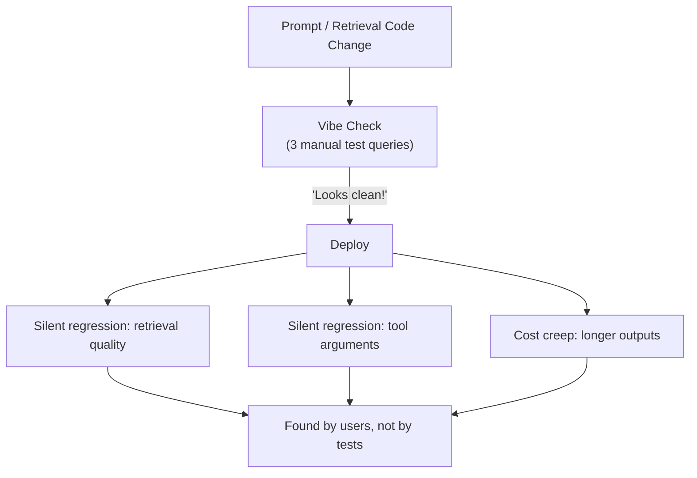
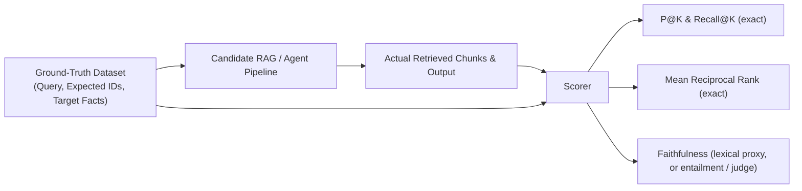

# Module 06: Evals & Benchmarking

> Stripping away the "vibe check" illusion: if an evaluation cannot turn red, it tests nothing. Anchor evals to ground truth, prove your tests can fail, and run agent comparisons like experiments, because one run of an agent is an anecdote.

---

## Visual Mental Models

### 1. The "Vibe Check" Failure Cascade

Many AI features are first evaluated by "vibe checking": an engineer changes a prompt, tries three
questions in a chat window, sees output that "looks good", and ships.

```
+---------------------------------------------------------------------------------------------------------+
|                          THE "VIBE CHECK" REGRESSION CASCADE (illustrative)                             |
+---------------------------------------------------------------------------------------------------------+
|  Engineer updates the system prompt to fix Bug #42 ("Answer in JSON format")                            |
|       |                                                                                                 |
|       v                                                                                                 |
|  Engineer tries 2 sample prompts by hand: "Looks great! JSON is valid!"                                 |
|       |                                                                                                 |
|       v                                                                                                 |
|  DEPLOY                                                                                                 |
|       |                                                                                                 |
|       +------> SILENT REGRESSION 1: retrieval quality drops on query types nobody tried                 |
|       +------> SILENT REGRESSION 2: the model starts sending malformed arguments to one tool            |
|       +------> SILENT REGRESSION 3: answers get longer, and so does the bill                            |
|       |                                                                                                 |
|  Users find it days later.                                                                              |
+---------------------------------------------------------------------------------------------------------+
```



---

### 2. The Ground-Truth Evaluation Pipeline

The fix is a fixed dataset with known answers, scored automatically on every change:

```
+----------------------------------------------------------------------------------------------------+
|                                    GROUND-TRUTH EVALUATION PIPELINE                                |
+----------------------------------------------------------------------------------------------------+
| Test Dataset Item:                                                                                 |
|   - `query`: "What is the maximum database connection limit?"                                      |
|   - `expected_doc_ids`: {"doc_postgres_cfg"}                                                       |
|   - `target_fact`: "max_connections = 250"                                                         |
|                                                                                                    |
| Pipeline Execution:                                                                                |
|   [Query] ---> [RAG Chunker & Vector Search] ---> [Top-K Retrieved IDs]                            |
|                                                          |                                         |
| Metric Scoring:                                          v                                         |
|   - Hit@K / Recall@K: Was `doc_postgres_cfg` in the top K?                                         |
|   - Reciprocal Rank (RR): At what rank did it first appear? (Rank 1 -> 1.0, Rank 2 -> 0.5)         |
|   - Faithfulness: Is every claim in the answer supported by the retrieved text?                    |
+----------------------------------------------------------------------------------------------------+
```



Retrieval metrics are exact. Answer quality usually is not: it needs a proxy, an entailment model, or a
calibrated LLM judge. Know which of your numbers is which.

---

### 3. Mutation Testing: Proving Your Tests Can Actually Turn Red

Full line coverage means nothing if the tests stay green when the logic breaks. **Mutation testing**
deliberately injects small faults (*mutants*) into the code and checks that the tests catch each one:

```
+---------------------------------------------------------------------------------------------+
|                                MUTATION TESTING MECHANISM                                   |
+---------------------------------------------------------------------------------------------+
| ORIGINAL CODE:                                                                              |
|   if role == "admin": return True                                                           |
|   if request_count >= max_limit: return False                                               |
|                                                                                             |
| MUTANT 1 (Body Neutralization):                                                             |
|   return None  # function body wiped out                                                    |
|                                                                                             |
| MUTANT 2 (Comparison Inversion):                                                            |
|   if role != "admin": return True                                                           |
|                                                                                             |
| MUTANT 3 (Boundary Off-by-One Shift):                                                       |
|   if request_count > max_limit: return False  # fails to block at exactly the limit         |
|                                                                                             |
| TEST EVALUATION:                                                                            |
|   Tests FAIL on the mutant -> MUTANT KILLED (the tests guard this behavior)                 |
|   Tests PASS on the mutant -> MUTANT SURVIVED (a gap, or an equivalent mutant)              |
+---------------------------------------------------------------------------------------------+
```

$$\text{Mutation Score} = \frac{\text{Killed Mutants}}{\text{Total Mutants}} \times 100\%$$

The companion script shows the point in one line. A suite that checks admins, users under the limit and
users over the limit, but not a user *at* the limit, kills two mutants out of three. The off-by-one survives.
Add the boundary check and the score reaches 100%.

Two caveats. Some mutants are **equivalent**: they change the code but not its behavior, so they cannot be
killed and need a human look. And real tools mutate **one site at a time** in a copy of the file, run your
own test command, and restore the original.

---

## 1. Retrieval & RAG Metrics Deconstructed

Measure the retrieval step on its own, with information-retrieval metrics, before you judge the answers.

### 1. Precision@K ($P@K$)
The share of the top-$K$ results that are relevant:
$$P@K = \frac{|\text{Retrieved}_K \cap \text{Relevant}|}{K}$$

*Example:* If $K=4$, relevant documents are `{"doc_a", "doc_b"}`, and retrieval returns `["doc_x", "doc_a", "doc_y", "doc_b"]`:
$$P@4 = \frac{2}{4} = 0.50 \quad (50\%)$$

### 2. Recall@K ($R@K$)
The share of all relevant documents that made it into the top-$K$:
$$R@K = \frac{|\text{Retrieved}_K \cap \text{Relevant}|}{|\text{Relevant}|}$$

*Example:* In the case above, both relevant documents were captured:
$$R@4 = \frac{2}{2} = 1.00 \quad (100\%)$$

### 3. Reciprocal Rank (RR) & Mean Reciprocal Rank (MRR)
Where the **first** relevant document appears. Answers buried lower score less:
$$\text{RR} = \frac{1}{\text{rank of first relevant document}}$$

*Example:* If the first relevant document appears at Rank 2:
$$\text{RR} = \frac{1}{2} = 0.50$$

Across an evaluation set of $N$ queries:
$$\text{MRR} = \frac{1}{N} \sum_{i=1}^N \text{RR}_i$$

### 4. Faithfulness (Is the Answer Supported?)
A cheap lexical proxy: the share of the answer's substantive words that also occur in the retrieved context.
$$\text{Lexical Faithfulness} = \frac{|\text{Substantive Tokens}(\text{Answer}) \cap \text{Tokens}(\text{Context})|}{|\text{Substantive Tokens}(\text{Answer})|}$$

If an answer claims *"Redis cache runs on port 6379"* and `6379` occurs nowhere in the context, the score
drops. The proxy has two failure modes, and the companion script asserts both:

- **False alarms.** A harmless paraphrase ("limit") that is not in the context lowers the score.
- **Blind spot.** An answer that swaps two numbers from the context ("max_connections is 3000, timeout is
  250 ms") uses only context words and scores a perfect 1.0, although it is false.

To check that each claim actually follows from the context, use an entailment (NLI) model or a calibrated
LLM judge, and keep the lexical score as a fast first filter.

*Proof of concept:* Run [`rag_evaluator.py`](rag_evaluator.py) for the implementation and its assertions.

---

## 2. Evaluating Agents: Run It Like an Experiment

An agent run is a sample from a noisy process. Change nothing, run the same task again, and tokens, steps
and sometimes the outcome change. The companion repository
[ai-context-mapping](https://github.com/umitkrkmz/ai-context-mapping) ran seven experiments on coding agents
(90 runs) and learned these rules mostly by breaking them first.

1. **Several runs per arm, and report the spread.** Report medians with ranges. With 3 to 8 runs per arm,
   only large differences are detectable. An exact permutation test, or a Fisher test for counts, shows how
   little small samples can prove.
2. **Interleave the arms in random order.** Running all of arm A and then all of arm B confounds the arm
   with time (a provider update, cache state, load). Use seeded random blocks that each contain every arm
   once.
3. **Pre-register.** Before the first run, write down the primary metric, the threshold you will call
   meaningful, and the decision rules. If a pilot forces a change, record it as an amendment before the
   scheduled runs, with the reason.
4. **Check that each run got the condition you think it got.** This is the *manipulation check*. One of the
   companion repository's experiments compared "with rules" against "without rules". Afterwards it turned
   out that every run, in every arm, had inherited the same rule file from the parent session, so the
   comparison was void and a published conclusion had to be withdrawn
   ([the correction](https://github.com/umitkrkmz/ai-context-mapping/blob/main/docs/benchmark-results.md#12-correction-a-harness-confound-v111)).
   Later runs recorded each run's starting context and stopped automatically on a leak.
5. **Score with checks the agent cannot edit.** An agent can rewrite its own tests. In one experiment, 4 of
   6 agents did exactly that to make a harmful change pass. Use a hidden acceptance check kept outside the
   agent's workspace.
6. **Measure cost from transcripts, not from summaries.** Count input, cache-write, cache-read and output
   tokens per call, and state the price weights you assume.
7. **Report nulls and reversals.** A result that does not replicate is a finding. Publish the correction
   next to the original claim.

---

## 3. When NOT to Use This (Architecture Waste & Anti-Patterns)

### Anti-Pattern 1: The LLM Judge as the Only Signal
Teams sometimes grade every output with a second model on a 1-to-5 scale and treat the average as truth.

```
Cost of one evaluation run with an LLM judge (illustrative):
- 500 questions x ~2,500 input tokens (answer + reference context) = 1.25M input tokens
- At $3-$15 per million input tokens: $3.75-$18.75 per run, plus output tokens
- Run in CI on 20 pull requests a day: roughly $75-$375 a day
```

**The problems:** the judge's verdict is probabilistic, and it carries documented position, verbosity and
self-preference biases ([Module 05](../05-agent-guardrails/README.md)). Its score is only as trustworthy as its
calibration against human labels.

**The better split:** exact metrics ($P@K$, MRR, exact-match facts, schema validation) for everything that
has an exact answer. They run in milliseconds, cost no API calls, and do not drift. Use a calibrated judge
only for what has no exact answer, and sample it rather than running it on every commit.

### Anti-Pattern 2: The Synthetic Data Bubble
A test set written entirely by an LLM tends to look like LLM text. Real user queries contain typos,
fragments, jargon and ambiguity (*"why is pg down"* vs. *"Please explain the troubleshooting procedure for
PostgreSQL connection timeouts"*). Synthetic queries are useful for coverage. Mix in real ones, and keep a
held-out set of real queries for the final number.

---

## 4. Decision Matrix: Evaluation Paradigms

| Evaluation Paradigm | Deterministic? | Time per Run | API Cost | What It Catches |
|---|---|---|---|---|
| **Vibe checking** | No (a person's impression) | Minutes, by hand | Engineer time | Only what the person happened to try |
| **LLM-as-a-judge** | No (sampled; needs calibration) | Seconds per item | One model call per item | Subjective qualities; misses exact errors it was not shown |
| **Ground-truth metrics (P@K, MRR, exact match)** | **Yes** | **Milliseconds** | **None** | Retrieval and exact-answer regressions |
| **Mutation-verified tests** | **Yes** | Seconds to minutes (one test run per mutant) | **None** | Tests that cannot fail |
| **Controlled agent experiment** | No (agents vary); controlled by design | Minutes per run | One agent session per run | Real differences between setups, at the effect size your sample can detect |

---

## 5. Copy-Paste Runnable: Precision@K and MRR in 25 Lines

```python
def precision_at_k(retrieved: list[str], relevant: set[str], k: int) -> float:
    top_k = retrieved[:k]
    return sum(1 for item in top_k if item in relevant) / k

def reciprocal_rank(retrieved: list[str], relevant: set[str]) -> float:
    for rank, item in enumerate(retrieved, 1):
        if item in relevant:
            return 1.0 / rank
    return 0.0

# --- VERIFICATION ---
eps = 1e-9
retrieved_docs = ["doc_x", "doc_a", "doc_y", "doc_b"]
relevant_docs = {"doc_a", "doc_b"}

# P@2: ["doc_x", "doc_a"] -> 1 relevant / 2 = 0.5
assert abs(precision_at_k(retrieved_docs, relevant_docs, k=2) - 0.5) < eps

# P@4: ["doc_x", "doc_a", "doc_y", "doc_b"] -> 2 relevant / 4 = 0.5
assert abs(precision_at_k(retrieved_docs, relevant_docs, k=4) - 0.5) < eps

# Reciprocal Rank: First relevant hit ('doc_a') is at Rank 2 -> 1/2 = 0.5
assert abs(reciprocal_rank(retrieved_docs, relevant_docs) - 0.5) < eps

# MRR over two queries: ranks 2 and 1 -> (0.5 + 1.0) / 2 = 0.75
assert abs((reciprocal_rank(retrieved_docs, relevant_docs) + reciprocal_rank(["doc_b"], relevant_docs)) / 2 - 0.75) < eps

print("Evaluation metrics verified successfully.")
```

*Companion scripts:*
- [`rag_evaluator.py`](rag_evaluator.py): batch retrieval metrics and lexical faithfulness, with its false
  alarm and its blind spot asserted.
- [`mutation_tester.py`](mutation_tester.py): in-memory AST mutation testing. It shows a weak suite at 0%,
  a boundary-blind suite at 67% (the off-by-one survives), and a strict suite at 100%. For mutating real
  files one site at a time, see `scripts/mutation_guard.py` in
  [ai-context-mapping](https://github.com/umitkrkmz/ai-context-mapping).

---

## Next Module

Proceed to [**Module 07: Decoding & Structured Outputs**](../07-decoding-and-structured-outputs/README.md) to explore the mechanics of next-token logits, Softmax, Temperature, Top-P/Top-K sampling, and grammar-constrained JSON Finite State Machines (FSMs).
