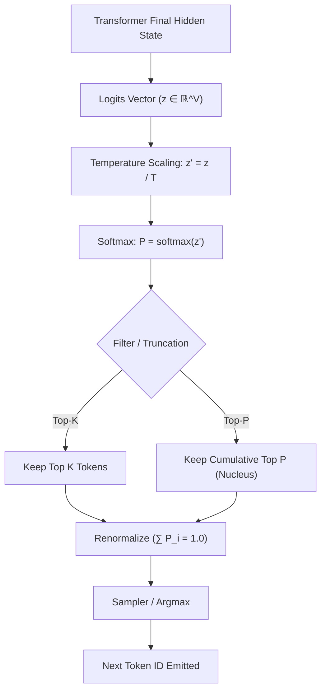
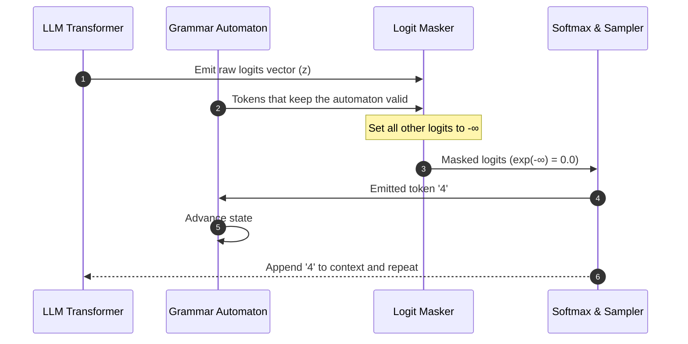

# Module 07: Decoding & Structured Outputs

> Stripping away the "JSON prompt engineering" illusion: the model outputs a probability for every token in its vocabulary, and a sampler picks one. Asking nicely for "ONLY valid JSON" changes those probabilities; masking illegal tokens removes them. Even masking guarantees syntax, not truth.

---

## Visual Mental Models

### 1. The Next-Token Decoding Pipeline

Every decoder-only language model ends each step the same way: one score (*logit*) per vocabulary token.
What happens next is a configurable *decoding strategy*. The common sampling path is:

```
+---------------------------------------------------------------------------------------------------------+
|                                    NEXT-TOKEN DECODING PIPELINE                                         |
+---------------------------------------------------------------------------------------------------------+
|  [Linear Projection Layer]   Hidden states are projected to vocabulary dimension V                      |
|       |                                                                                                 |
|       v                                                                                                 |
|  [Raw Logits Vector]         z = [2.4, -0.8, 8.1, ..., 0.3] (Unnormalized floats in R^V)                |
|       |                                                                                                 |
|       v                                                                                                 |
|  [Temperature Division]      z'_i = z_i / T                                                             |
|       |                      (T -> 0: sharpens toward the top token; T > 1.0: flattens)                  |
|       v                                                                                                 |
|  [Softmax]                   P_i = exp(z'_i - max(z')) / sum(exp(z'_j - max(z')))                       |
|       |                      Turns logits into a probability distribution (sum = 1.0)                   |
|       v                                                                                                 |
|  [Top-K / Top-P Filtering]   Drops the improbable tail and renormalizes what is left                    |
|       |                                                                                                 |
|       v                                                                                                 |
|  [Sampling]                  Draws the next token ID (or takes the argmax if greedy)                    |
+---------------------------------------------------------------------------------------------------------+
```

Engines differ in the order of these steps and add others: repetition penalties, min-p, beam search. The
building blocks are the same.



---

### 2. Why Prompt-Only JSON Fails Intermittently

Engineers often write prompts like:
```text
"You are a strict data extraction API. Return ONLY a valid JSON object matching this schema.
DO NOT include markdown backticks. DO NOT include explanations. Output valid JSON or the system will crash."
```

Such a prompt makes valid JSON *likely*. It cannot make invalid output *impossible*, because the sampler can
still pick any token with a non-zero probability:

```
+----------------------------------------------------------------------------------------------------+
|                                    TOKEN-LEVEL HAZARDS (illustrative)                              |
+----------------------------------------------------------------------------------------------------+
| 1. The preamble: in training text, JSON is often preceded by "Here is the JSON:" or "```json\n".   |
|    Those tokens keep some probability at the first step.                                           |
|----------------------------------------------------------------------------------------------------|
| 2. The wrong type: at `"age": `, the model can emit `"30"` (a string) or a word instead of `30`.   |
|----------------------------------------------------------------------------------------------------|
| 3. The trailing comma: `{"a": 1, "b": 2,}` is legal in JavaScript object literals and in Python,  |
|    but not in JSON; Python's `json` module rejects it.                                             |
+----------------------------------------------------------------------------------------------------+
```

Modern models trained for instruction following get this right most of the time. "Most of the time" is
exactly the problem at scale.

---

### 3. Grammar-Constrained Decoding via Logit Masking

Instead of hoping, **constrained decoding** compiles the target grammar (a JSON Schema, a regular
expression, a context-free grammar) into an automaton. At every step it sets the logits of tokens that
would break the grammar to $-\infty$ *before* sampling:

```
+----------------------------------------------------------------------------------------------------+
|                                    GRAMMAR LOGIT MASKING                                           |
+----------------------------------------------------------------------------------------------------+
| Current State: EXPECT_INTEGER (field "age"), first character                                      |
| Legal Tokens:  tokens that keep a valid integer prefix: "-", "1".."9", "0", "42", "4", ...        |
| Illegal Tokens: {"a".."z", "{", "}", ",", "```", "thirty", "\"", ...}                              |
|                                                                                                    |
| Masking:                                                                                           |
| for token_id in vocabulary:                                                                        |
|     masked[token_id] = raw[token_id] if legal(state, token_id) else -inf                           |
|                                                                                                    |
| Softmax: exp(-inf) = 0.0, so an illegal token can never be sampled.                                |
| This holds at every step: one forward pass per token, as always, and no retries.                   |
+----------------------------------------------------------------------------------------------------+
```

The hard part in a real engine is the word *legal*. Tokens are multi-character fragments that do not line
up with JSON syntax (`":`, `Al` + `ice"`), so the engine must know, for every automaton state, which of
tens of thousands of vocabulary tokens keep the automaton in a valid state. Willard & Louf (2023),
*Efficient Guided Generation for Large Language Models* (the method behind Outlines), precompute that
index. llama.cpp grammars and the structured-output modes of hosted APIs use the same idea.



---

### 4. Three Different Guarantees

"Structured output" can mean three things. Do not confuse them:

| Guarantee | Question | What provides it |
| --- | --- | --- |
| **Syntax** | Does it parse as JSON? | Constrained decoding, if the run finishes. A token limit can still cut the document off mid-way. |
| **Schema** | Are the required keys there, with the right types and enums? | Constrained decoding *only if* the grammar encodes the schema; otherwise validation after the fact. |
| **Meaning** | Are the values true to the input? | Nothing in decoding. Only evaluation against ground truth ([Module 06](../06-evals-and-benchmarking/README.md)) or a review. |

[`json_grammar_fsm.py`](json_grammar_fsm.py) asserts all three. Masked decoding turns noisy logits into a
parseable, schema-valid object. Cutting the same run at a token budget leaves a valid prefix that does not
parse. And the schema-valid object it produces, `{"name": "Bob", "age": 30, ...}`, is wrong for an input
that said Alice, 42.

Constraints have a cost too. Tam et al. (2024), *Let Me Speak Freely?*, found that strict format
restrictions can lower accuracy on reasoning tasks. One common mitigation is to let the model reason in
free text first and constrain only the final structured answer.

---

## 1. Hyperparameters Deconstructed (The Raw Math)

### 1. Temperature ($T$)
Temperature scales the logits before the exponent in Softmax:
$$P_i = \frac{e^{z_i / T}}{\sum_{j} e^{z_j / T}}$$

- **As $T \to 0$ (greedy / argmax):**
  The gaps between logits are amplified without bound. The top token's probability goes to $1.0$ and all
  others to $0.0$, so in exact arithmetic the choice is deterministic. In practice, served models are often
  not bit-for-bit reproducible even at temperature 0, because batching and floating-point reduction order
  change the logits slightly.
- **As $T \to \infty$ (uniform):**
  $z_i / T \to 0$, so $e^0 = 1$. Every token gets the same probability $P_i = \frac{1}{V}$, and the output is
  noise.
- **Rule of thumb:** extraction, code and structured data usually want a low temperature. Creative text
  tolerates more. Measure the error rate on your own task rather than trusting a fixed number.

### 2. Top-K Sampling
Keep only the $K$ most probable tokens and renormalize:
$$P'_i = \begin{cases} \frac{P_i}{\sum_{k \in \text{TopK}} P_k} & \text{if } i \in \text{TopK} \\ 0 & \text{otherwise} \end{cases}$$

This prevents sampling from the long tail while keeping some variety among the top candidates.

### 3. Top-P (Nucleus) Sampling
Holtzman et al. (2020), *The Curious Case of Neural Text Degeneration*. Instead of a fixed count, keep the
smallest set of tokens whose cumulative probability reaches $p$:
$$\sum_{i \in \text{Nucleus}} P_i \ge p$$

- When the model is confident, one token can hold $P = 0.96$, and the nucleus is that single token
  (effectively greedy).
- When the distribution is flat, the nucleus grows to many tokens.

*Proof of concept:* Run [`sampling_math.py`](sampling_math.py) for numerical checks of stable softmax, the temperature limits, Top-K and Top-P.

---

## 2. When NOT to Use This (Architecture Waste & Anti-Patterns)

### Anti-Pattern 1: Retrying Until It Parses
A common loop:

<!-- verify_all: illustrative fragment, not executed -->
```python
# Retry until it parses, re-sending the traceback each time
for attempt in range(5):
    response = llm.generate(prompt)
    try:
        data = json.loads(response)
        user = UserModel(**data)  # schema validation, e.g. Pydantic
        break
    except Exception as err:
        prompt += f"\nPrevious attempt failed with error: {err}. Fix it!"
```

```
The cost of the retry loop (illustrative):
- Attempt 1: 1,500 input tokens, 200 output tokens (~800ms)   -> fails (trailing comma)
- Attempt 2: 1,800 input tokens, 200 output tokens (~900ms)   -> fails (missing key)
- Attempt 3: 2,100 input tokens, 200 output tokens (~1,100ms) -> succeeds
Total latency: 2,800ms, about 3.5x one call. Input tokens: 5,400, about 3.6x one call.
```

**The fix:** constrained decoding (Outlines, llama.cpp grammars, or an API's schema-enforced structured
output mode) removes the *syntax and schema* retries. Masking itself costs some time per token. Keep the
validation step anyway: it is where you check business rules ("end date after start date") that no grammar
expresses, and that check may still need a retry.

---

## 3. Decision Matrix: Structured Output Approaches

| Approach | Syntax | Schema | Meaning | Latency / Tokens | Availability |
|---|---|---|---|---|---|
| **Prompt-only JSON** | Usually | Usually | Not checked | 1x | Any model |
| **Validate and retry** | Eventually (bounded retries) | Eventually | Only rules you code | 1x when it works; more per retry | Any model |
| **Constrained decoding** | **Yes**, unless truncated | **Yes**, if the grammar encodes it | Not checked | ~1x, no format retries; some masking overhead | Local engines; APIs with schema-enforced output |
| **Constrained decoding + validation + eval** | Yes | Yes | Measured against ground truth | As above, plus validation | The combination for production |

---

## 4. Copy-Paste Runnable: Numerically Stable Softmax & Logit Masking

```python
import math

def softmax_with_mask(logits: dict[str, float], allowed_tokens: set[str], temperature: float = 1.0) -> dict[str, float]:
    # 1. Apply Logit Mask: non-allowed tokens get -inf
    masked = {t: (z / temperature if t in allowed_tokens else -float("inf")) for t, z in logits.items()}

    # 2. Subtract max for numerical stability (ignoring -inf)
    valid_logits = [z for z in masked.values() if z != -float("inf")]
    if not valid_logits:
        raise ValueError("No legal tokens available in current state!")
    max_z = max(valid_logits)

    # 3. Softmax
    exp_vals = {t: (math.exp(z - max_z) if z != -float("inf") else 0.0) for t, z in masked.items()}
    total = sum(exp_vals.values())
    return {t: p / total for t, p in exp_vals.items()}

# --- VERIFICATION ---
eps = 1e-6
raw_logits = {"{": 2.0, "```json": 10.0, "Sure!": 8.5}
# At start of JSON, only '{' is allowed:
allowed = {"{"}

probs = softmax_with_mask(raw_logits, allowed)

# Noisy tokens receive exactly 0.0 probability, however high their logits were
assert probs["```json"] == 0.0
assert probs["Sure!"] == 0.0
# The only legal token receives all the probability
assert abs(probs["{"] - 1.0) < eps

print("Logit masking verified: illegal tokens get probability 0.0.")
```

*Companion scripts:*
- [`sampling_math.py`](sampling_math.py): temperature, Top-K, Top-P and seeded sampling.
- [`json_grammar_fsm.py`](json_grammar_fsm.py): a toy grammar automaton driving masked decoding, with
  assertions for what it guarantees (parseable, schema-valid output) and what it does not (a complete
  document under a token limit, correct values).

---

## Next Module

Proceed to [**Module 08: Hardware, VRAM & Quantization Mechanics**](../08-hardware-vram-quantization/README.md) to explore GPU memory accounting, FP16/INT8/INT4 quantization math, and KV cache sizing formulas.
