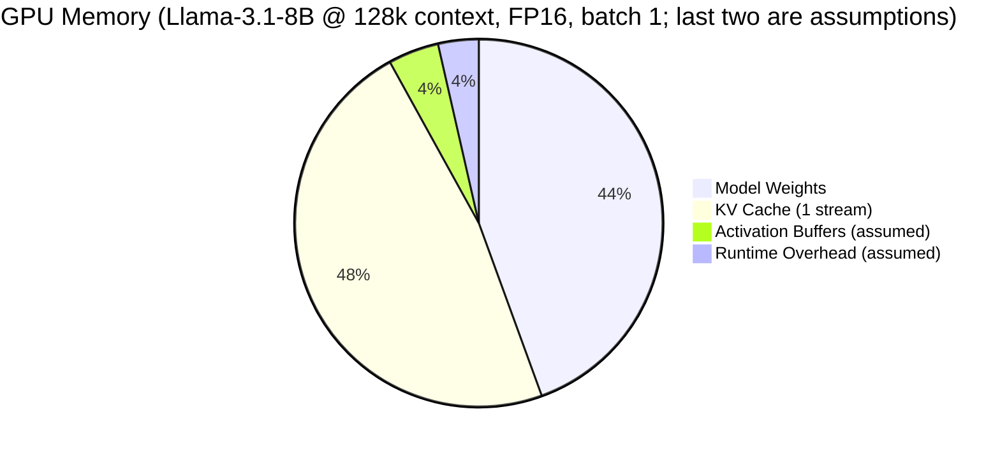
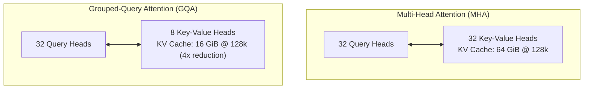

# Module 08: Hardware, VRAM & Quantization Mechanics

> Stripping away the "AI hardware magic" illusion: serving an LLM is memory accounting. Size a GPU for the weights alone and it fails once the KV cache grows. And memory *capacity* (does it fit?) is a different question from memory *bandwidth* (how fast does it generate?).

---

## Visual Mental Models

### 1. Anatomy of GPU Memory During LLM Serving

When you serve an LLM on a GPU (for example a 24 GB RTX 4090 or an 80 GB H100), its memory holds four
kinds of things:

```
+---------------------------------------------------------------------------------------------------------+
|                                    TOTAL GPU MEMORY ALLOCATION                                          |
+---------------------------------------------------------------------------------------------------------+
|  [STATIC MODEL WEIGHTS]       Loaded once. Size = Params * Bytes_per_Param                              |
|  (e.g., Llama-3.1-8B in FP16: 8.03B params * 2 bytes = ~14.96 GiB)                                      |
|---------------------------------------------------------------------------------------------------------|
|  [KV CACHE]                   Grows with every token held in context, across all active requests.      |
|  (e.g., one 128k-token stream: 2 * 131,072 * 32 layers * 8 KV heads * 128 * 2 bytes = 16.0 GiB)         |
|---------------------------------------------------------------------------------------------------------|
|  [ACTIVATION BUFFERS]         Intermediate tensors of the forward pass (engine- and batch-dependent)    |
|---------------------------------------------------------------------------------------------------------|
|  [RUNTIME OVERHEAD]           CUDA context, library workspaces, allocator fragmentation                 |
+---------------------------------------------------------------------------------------------------------+
```



The point of the picture: **at a 128k context, the KV cache of a single conversation (16 GiB) is larger
than the model itself (15 GiB).** The last two slices vary by engine; measure them on your stack.

---

### 2. Quantization Arithmetic: Continuous to Discrete

Quantization does not change the transformer's architecture. It stores numbers (usually the weights, and
sometimes the activations or the KV cache) at lower precision: 8 or 4 bits instead of 16 or 32.

```
Continuous Float Domain:  [-2.4510 ..................... 0.0000 ..................... +3.1950]
                                      |                       |                       |
                                      v                       v                       v
Discrete INT8 Grid:       [-128 ....................... -17 ........................ +127]
                          q_min                          Zero-Point Z                 q_max
```

The affine mapping uses two numbers per tensor (or per block of a tensor). First, widen the range to
include zero ($x_{\min} \le 0 \le x_{\max}$), so that zero is always exactly representable. Then:
1. **Scale factor ($S$):** the real-number size of one integer step:
   $$S = \frac{x_{\max} - x_{\min}}{q_{\max} - q_{\min}} = \frac{x_{\max} - x_{\min}}{255}$$
2. **Zero-Point ($Z$):** the integer that represents $0.0$:
   $$Z = \text{round}\left(\frac{-x_{\min}}{S}\right) + q_{\min}$$

For the range above, $S = 5.646 / 255 \approx 0.0221$ and $Z = \text{round}(110.7) - 128 = -17$.

$$\text{Quantize: } q = \text{clamp}\left(\text{round}\left(\frac{x}{S}\right) + Z, -128, 127\right)$$

$$\text{Dequantize: } \hat{x} = S \times (q - Z)$$

Each value is reconstructed to within $S/2$ (half a step). *Compression:* FP32 uses 4 bytes per value and
INT8 uses 1, a $4\times$ reduction (or $2\times$ from FP16), plus a few bytes of scale and zero point per
tensor or block.

---

### 3. Attention Memory Scaling: MHA vs. GQA

In standard Multi-Head Attention (MHA), every query head has its own key head and value head
($n_{\text{kv\_heads}} = n_{\text{q\_heads}}$). **Grouped-Query Attention (GQA)** lets several query heads
share one key/value head, which shrinks the KV cache by the same factor:

```
+---------------------------------------------------------------------------------------------+
|                                  ATTENTION ARCHITECTURES                                    |
+---------------------------------------------------------------------------------------------+
| Multi-Head Attention (MHA) [e.g. Llama 1 / GPT-3]:                                          |
|   Q Heads (32) ----> [Q0] [Q1] [Q2] [Q3] ... [Q31]                                          |
|   KV Heads (32) ---> [K0] [K1] [K2] [K3] ... [K31] (1:1 ratio)                             |
|                                                                                             |
| Grouped-Query Attention (GQA) [e.g. Llama 3 / Mistral 7B]:                                  |
|   Q Heads (32) ----> [Q0  Q1  Q2  Q3]  ...  [Q28 Q29 Q30 Q31]                               |
|                        \   /   /   /              \   /   /   /                                 |
|   KV Heads (8) ---->     [KV 0]         ...         [KV 7]    (4:1 ratio -> 4x less KV)     |
+---------------------------------------------------------------------------------------------+
```



---

## 1. The Raw Memory Formulas

### 1. Model Weights
$$\text{Weight Memory (GiB)} = \frac{\text{Params} \times \left(\frac{\text{Bits}}{8}\right)}{1024^3}$$

| Model (parameters) | FP16 (2 bytes) | INT8 (1 byte) | INT4 (0.5 bytes) |
|---|---|---|---|
| **Llama 3.1 8B (8.03B)** | $\sim 15.0\text{ GiB}$ | $\sim 7.5\text{ GiB}$ | $\sim 3.7\text{ GiB}$ |
| **Llama 3.1 70B (70.6B)** | $\sim 131.5\text{ GiB}$ | $\sim 65.7\text{ GiB}$ | $\sim 32.9\text{ GiB}$ |
| **Llama 3.1 405B (405B)** | $\sim 754.4\text{ GiB}$ | $\sim 377.2\text{ GiB}$ | $\sim 188.6\text{ GiB}$ |

Real 4-bit formats store a scale (and often a zero point) for every small block of weights, which adds a
few percent to these figures.

### 2. KV Cache Formula
For every token in context, each layer keeps one key vector and one value vector per KV head:

$$\text{KV Cache Bytes} = 2 \times \text{Batch} \times \text{SeqLen} \times n_{\text{layers}} \times n_{\text{kv\_heads}} \times d_{\text{head}} \times \text{bytes\_per\_element}$$

Where:
- $2$: one key and one value.
- $\text{Batch}$: concurrent sequences being served.
- $\text{SeqLen}$: tokens currently in context.
- $n_{\text{layers}}$: number of transformer blocks (32 for the 8B model).
- $n_{\text{kv\_heads}}$: key/value heads (8 for Llama 3 8B, rather than 32).
- $d_{\text{head}}$: dimension per head ($4096 / 32 = 128$).
- $\text{bytes\_per\_element}$: $2$ for FP16/BF16, $1$ for an FP8 or INT8 KV cache.

*Worked example (Llama-3.1-8B at a 128k context, batch 1, FP16):*
$$\text{KV Bytes} = 2 \times 1 \times 131,072 \times 32 \times 8 \times 128 \times 2 = 17,179,869,184\text{ bytes} = 16.00\text{ GiB}$$

With MHA instead of GQA (32 KV heads):
$$\text{KV Bytes (MHA)} = 16.00\text{ GiB} \times 4 = 64.00\text{ GiB} \quad (\text{more than any single consumer GPU holds})$$

### 3. Capacity Is Not Speed
Fitting in memory says nothing about how fast tokens come out. At batch size 1, generating each new token
(the *decode* step) reads every weight, plus the whole KV cache, from GPU memory once. Memory bandwidth
therefore caps decode speed:

$$\text{tokens/s} \le \frac{\text{memory bandwidth}}{\text{weight bytes} + \text{KV cache bytes}}$$

| Llama-3.1-8B on a GPU with about 1,000 GB/s | Ceiling |
| --- | --: |
| FP16 weights, short context | about 62 tokens/s |
| FP16 weights, 128k context (16 GiB of KV read per token) | about 30 tokens/s |
| INT4 weights, short context | about 250 tokens/s |

These are upper bounds; real engines reach a fraction of them. Two more effects matter:
- **Prefill** (reading the prompt) processes many tokens at once and is usually limited by compute, not
  bandwidth.
- **Batching** shares each weight read across many requests. That is why servers batch, and why throughput
  per GPU and latency per user are different numbers.

*Proof of concept:* Run [`vram_calculator.py`](vram_calculator.py) for memory budgets and the bandwidth ceiling.

---

## 2. When NOT to Use This (Architecture Waste & Anti-Patterns)

### Anti-Pattern 1: The "Weight-Only" Memory Estimate
An engineer buys a 24 GB RTX 4090 to serve Llama-3.1-8B locally:
- *"The model is 8B in FP16, about 15 GiB. That leaves 9 GiB to spare!"*

**What happens** (with 1.5 GiB of activations and 1.2 GiB of runtime overhead assumed):
- Short conversations work.
- At $32\text{k}$ tokens of context:
  $$\text{Weights (15.0)} + \text{KV (4.0)} + \text{Activations (1.5)} + \text{Overhead (1.2)} = 21.7\text{ GiB}$$
  It still fits.
- At $64\text{k}$ tokens:
  $$15.0 + 8.0 + 1.5 + 1.2 = 25.7\text{ GiB}$$
  That is more than the card holds.

How it fails depends on the server. A naive script crashes with a CUDA out-of-memory error. Serving
engines that reserve a fixed KV budget at startup (vLLM's PagedAttention, for example) instead cap the
context length or the number of concurrent requests, and queue or preempt the rest. Either way, the
capacity you planned for is not there.

**The fix:** size for **weights + peak KV cache (context length x concurrency) + overhead**, and quantize
where it helps. On a 24 GB card: INT4 weights (about 3.7 GiB plus block scales) and an FP8 KV cache at 128k
(8.0 GiB), plus the 2.7 GiB of assumed overhead, come to about 14.4 GiB. That leaves roughly 9 GiB of
headroom.

### Anti-Pattern 2: Naive 4-bit Quantization and Outliers
Large transformers develop a few **outlier features**: activation dimensions with magnitudes far larger
than the rest. Dettmers et al. (2022) documented them in *LLM.int8()*. One huge value forces a large scale
$S$ for its whole tensor, which squeezes the many normal values into a handful of quantization levels and
loses their information. The practical methods each handle this differently:

- **LLM.int8()** keeps the outlier dimensions in FP16 and quantizes the rest to INT8.
- **SmoothQuant** (Xiao et al., 2022) moves the outlier scale from activations into weights with
  per-channel scaling, so both can be 8-bit.
- **GPTQ** (Frantar et al., 2022) quantizes weights layer by layer and corrects each layer's rounding
  error using second-order information.
- **AWQ** (Lin et al., 2023) uses activation magnitudes to find the small fraction of salient weight
  channels and scales them before quantizing.
- **Block-wise scales** (for example llama.cpp's k-quant types, stored in the GGUF file format) give every
  small block its own scale, so one outlier only affects its block.

---

## 3. Decision Matrix: Precision Choices

| Format | Bits per Weight | Quality (measure on your task) | Memory vs FP16 | Speed |
|---|---|---|---|---|
| **FP16 / BF16** | 16 | Baseline | $1\times$ | Baseline |
| **INT8 / FP8** (LLM.int8(), SmoothQuant, FP8 kernels) | 8 | Usually very close to baseline | $\sim 2\times$ smaller | Often faster at low batch (less to read); depends on kernels |
| **4-bit** (GPTQ, AWQ, GGUF k-quants) | ~4 to 5 with scales | Small, model- and task-dependent loss | $\sim 3.5\times$ smaller | Often much faster at batch 1 decode; less gain when compute-bound |
| **2-3 bit** | 2 to 3 | Large loss with most methods today | $\sim 6\times$ smaller | Rarely worth it without specialized methods |

Published perplexity numbers differ by model, method and benchmark. Run your own evaluation
([Module 06](../06-evals-and-benchmarking/README.md)) on your own task before choosing a format.

---

## 4. Copy-Paste Runnable: Affine Quantization in 20 Lines

```python
def quantize_affine(floats: list[float]) -> tuple[list[int], float, int]:
    x_min, x_max = min(min(floats), 0.0), max(max(floats), 0.0)  # the range must include zero
    scale = (x_max - x_min) / 255.0 or 1.0                       # all-zero input: any scale works
    zero_point = round(-x_min / scale) - 128
    quantized = [max(-128, min(127, round(x / scale) + zero_point)) for x in floats]
    return quantized, scale, zero_point

def dequantize_affine(quantized: list[int], scale: float, zero_point: int) -> list[float]:
    return [scale * (q - zero_point) for q in quantized]

# --- VERIFICATION ---
for raw_weights in ([-2.5, -1.0, 0.0, 1.2, 3.0], [1.0, 2.0, 3.0], [-0.7, -0.2], [0.0, 0.0]):
    q_bytes, s, z = quantize_affine(raw_weights)
    reconstructed = dequantize_affine(q_bytes, s, z)
    assert all(-128 <= q <= 127 for q in q_bytes) and -128 <= z <= 127
    # every value comes back within half a step (S / 2), including one-sided ranges
    assert max(abs(o - r) for o, r in zip(raw_weights, reconstructed)) <= s / 2 + 1e-9

print("INT8 affine quantization verified.")
```

*Companion scripts:*
- [`vram_calculator.py`](vram_calculator.py): weight and KV cache memory across precisions, contexts and
  GQA ratios, plus the bandwidth ceiling on decode speed. Its overhead figures are stated assumptions.
- [`int8_quantizer.py`](int8_quantizer.py): the full affine INT8 quantizer with error checks. An earlier
  version broke on all-positive and constant tensors; those cases are tested now.

---

## Master Repository Verification

To execute and verify all 8 modules across the entire repository in a single command:

```bash
python verify_all.py
```
