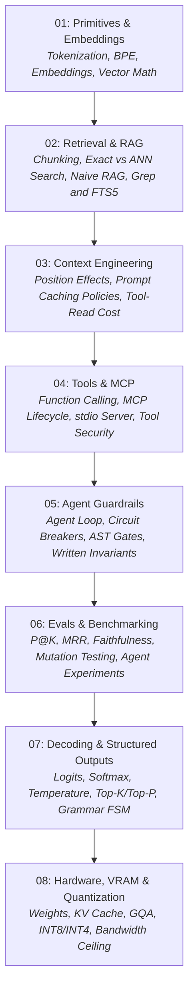

# how-ai-actually-works

> A first-principles engineering guide to the mechanisms behind modern AI systems. Standard-library Python, only the math each mechanism needs, runnable code, and clear mental models.

[](https://www.python.org/downloads/)
[](LICENSE)
[](#the-5-invariant-rules)

---

## The Manifesto: "The Magic Evaporates When You Look at the Matrix"

AI engineering has gathered a thick layer of jargon, wrapper libraries and marketing that present the
technology as something beyond inspection.

**It is not.** Each mechanism underneath is ordinary engineering:

- An **embedding** is a list of floating-point numbers: coordinates in a space whose geometry a model
  learned during training. What counts as "similar" is whatever that training placed close together.
- **Semantic similarity** is the cosine of the angle between two of those vectors.
- A **tokenizer** is a learned list of pair merges, applied in order, plus a lookup table from pieces to
  integer IDs.
- **RAG** (Retrieval-Augmented Generation) has a simple skeleton: retrieve some text, then concatenate it
  into the prompt. The hard parts (what to retrieve, how to rank it, whether the answer stays grounded in
  it) are search and evaluation problems.
- An **agent** is a loop: call the model, run the tool calls it emits, append the results, and repeat until
  it stops or a budget runs out.
- The **Model Context Protocol (MCP)** is JSON-RPC 2.0 messages with a defined lifecycle (initialization,
  version and capability negotiation, then requests such as tool calls), carried over stdio or HTTP.

Build each mechanism once in a few dozen lines of standard Python and the mystery goes. What remains is
systems engineering, with all its usual trade-offs.

The small implementations here show the mechanisms. They do not model production systems in full, and
the modules say where the difference matters.

---

## The 5 Invariant Rules

Every module, guide and script in this repository follows five rules:

```
+---------------------------------------------------------------------------------------+
|                               THE 5 INVARIANT RULES                                   |
+---------------------------------------------------------------------------------------+
|  1. FIRST PRINCIPLES FIRST  | No Chroma, LangChain or FAISS before the mechanism is   |
|                             | built in plain standard-library Python.                 |
|-----------------------------+---------------------------------------------------------|
|  2. COMPULSORY ANTI-PATTERNS| Every module has a "When NOT to use this" section with  |
|                             | cost, latency and failure trade-offs.                   |
|-----------------------------+---------------------------------------------------------|
|  3. RUNNABLE, ASSERTED CODE | Every script and every runnable README block executes   |
|                             | as is and ends in assertions that prove its behavior.   |
|-----------------------------+---------------------------------------------------------|
|  4. VISUAL MENTAL MODELS    | Every module opens with ASCII or Mermaid diagrams       |
|                             | before formulas and code.                               |
|-----------------------------+---------------------------------------------------------|
|  5. NO HYPE, SOURCED CLAIMS | No marketing adjectives. Every claim has a source, a    |
|                             | measurement, or a label saying it is an assumption.     |
+---------------------------------------------------------------------------------------+
```

1. **First principles before libraries.**
   No external framework, vector database or SDK appears before the mechanism has been built in plain
   standard-library Python. The repository has no third-party dependencies.
2. **Compulsory anti-patterns and decision matrices.**
   Every module has a section titled `When NOT to Use This (Architecture Waste & Anti-Patterns)`. It weighs
   cost, latency and failure modes against boring alternatives such as grep, regex, SQLite FTS5 or a plain
   script.
3. **Runnable, asserted code.**
   Every script is self-contained and ends with `assert` statements that check its claims. One script is
   the exception: the MCP server in module 04 is a long-running process, and its client tester drives it
   through every protocol path. `verify_all.py` also runs every `python` block in the module READMEs and
   fails a block that has no `assert`. The short fragments inside anti-pattern sections show the shape of
   a mistake and are not meant to run on their own; each carries a marker, and the harness lists them as
   skipped.
4. **Visual mental models (Mermaid and ASCII).**
   Each module draws the data flow, matrix operation or protocol exchange before it goes into
   implementation details.
5. **No hype, sourced claims.**
   Written for experienced engineers who care about determinism, observable latency, cost and
   maintainability. Numbers come from a cited paper, a measurement in this repository or the companion
   repository, or a stated assumption.

---

## Curriculum



| Module | Core Question | Mechanics Covered | Boring Alternative Explored |
|---|---|---|---|
| [**01. Primitives & Embeddings**](01-primitives-and-embeddings/README.md) | How does text become numbers a model can compare? | BPE merges, the embedding-matrix lookup, text embeddings from an encoder, dot product, cosine similarity, unit normalization. | Regex, substring search, hash maps, SQLite FTS5. |
| [**02. Retrieval & RAG**](02-retrieval-and-rag/README.md) | How does a system find the text to put in a prompt? | Fixed, sliding-window and structural chunking; exact flat search vs ANN; the naive RAG skeleton and what production systems add to it. | `grep`, ripgrep, SQLite FTS5 (BM25). |
| [**03. Context Engineering**](03-context-engineering/README.md) | Why do large prompts cost more and often work worse? | Position effects ("Lost in the Middle"), prefill cost, multi-turn token growth, three prompt-caching policies, the cost of tool reads. | A small static prefix plus targeted reads. |
| [**04. Tools & MCP**](04-tools-and-mcp/README.md) | How does a model call a tool? | JSON Schema tool definitions, the host loop that executes tool calls, MCP lifecycle, version and capability negotiation, JSON-RPC error codes, tools as an attack surface. | A deterministic script or CLI called directly. |
| [**05. Agent Guardrails**](05-agent-guardrails/README.md) | Why do agents derail, and what stops them? | The agent loop (Thought → Action → Observation), repetition and drift, step budgets, AST gates and their blind spots, LLM-as-a-judge biases, the measured effect of written invariants. | AST checks, pre-commit hooks, tests the agent cannot edit. |
| [**06. Evals & Benchmarking**](06-evals-and-benchmarking/README.md) | How do you measure quality without "vibes"? | Precision@K, Recall@K, MRR, a lexical faithfulness check and its blind spots, mutation testing, running agent evaluations as experiments. | Deterministic test suites over a labeled dataset. |
| [**07. Decoding & Structured Outputs**](07-decoding-and-structured-outputs/README.md) | How do you get output a program can parse, and what does that guarantee? | Logits, stable softmax, temperature, top-k, top-p, grammar-constrained decoding with a finite state machine; syntax vs schema vs meaning. | Validate and retry, with a retry bound. |
| [**08. Hardware, VRAM & Quantization**](08-hardware-vram-quantization/README.md) | How much memory does a model need, and how fast can it decode? | Weight memory at FP16/INT8/INT4, KV cache sizing, GQA, affine quantization with a zero point, the memory-bandwidth ceiling on decode speed. | A hosted API, a smaller model, CPU offloading. |

---

## The Companion Repository: ai-context-mapping

This repository and [**ai-context-mapping**](https://github.com/umitkrkmz/ai-context-mapping) are two halves
of one project:

- **This repository explains the mechanisms** with small implementations you can read in one sitting.
- **ai-context-mapping applies them** to AI coding agents working in a real repository: a project map,
  negative invariants, an AST verifier, a mutation guard, an MCP context server, and hooks for Claude Code.
  It also publishes pre-registered experiments that measure whether those guardrails change agent behavior.

| Here (the mechanism) | There (the applied tool or the evidence) |
|---|---|
| [Module 03](03-context-engineering/README.md): context size, caching and tool reads | [Experiment 5](https://github.com/umitkrkmz/ai-context-mapping/blob/main/docs/benchmark-results.md#13-experiment-5-the-framework-as-an-adopter-runs-it-v120): what targeted context costs and saves in a real agent session |
| [`minimal_mcp_server.py`](04-tools-and-mcp/minimal_mcp_server.py) | [`mcp/context_server.py`](https://github.com/umitkrkmz/ai-context-mapping/blob/main/mcp/context_server.py) |
| [`ast_guardrail.py`](05-agent-guardrails/ast_guardrail.py) | [`scripts/verify_invariants.py`](https://github.com/umitkrkmz/ai-context-mapping/blob/main/scripts/verify_invariants.py) |
| [Module 05](05-agent-guardrails/README.md): written invariants vs mechanical checks | [Experiments 6 and 7](https://github.com/umitkrkmz/ai-context-mapping/blob/main/docs/benchmark-results.md#14-experiment-6-do-the-guardrails-stop-a-harmful-change-v130): whether written reasons stop a harmful change, and how wording causes over-blocking |
| [`mutation_tester.py`](06-evals-and-benchmarking/mutation_tester.py) | [`scripts/mutation_guard.py`](https://github.com/umitkrkmz/ai-context-mapping/blob/main/scripts/mutation_guard.py) |
| [Module 06](06-evals-and-benchmarking/README.md): evaluating agents like an experiment | [The full benchmark report](https://github.com/umitkrkmz/ai-context-mapping/blob/main/docs/benchmark-results.md), including a published correction |

---

## Directory Structure

```text
how-ai-actually-works/
├── README.md
├── LICENSE
├── CONTRIBUTING.md            # The rules for contributions, and how to mark a README fragment
├── verify_all.py              # Runs the 15 scripts and every runnable README block, each in a fresh subprocess
├── 01-primitives-and-embeddings/
│   ├── README.md              # Tokens, BPE, the two kinds of embeddings, vector math, decision matrix
│   ├── cosine_math.py         # Pure Python vector math, normalization, flat search
│   └── bpe_tokenizer.py       # Minimal BPE tokenizer: train, encode, decode
├── 02-retrieval-and-rag/
│   ├── README.md              # Chunking failure modes, exact flat vs ANN, what production RAG adds
│   ├── naive_rag.py           # End-to-end naive RAG skeleton in the standard library
│   └── chunking_comparison.py # Fixed vs sliding-window vs structural chunking on one document
├── 03-context-engineering/
│   ├── README.md              # Position effects, prefill cost, caching policies, tool-read cost
│   ├── kv_cache_calculator.py # Multi-turn token growth and cost under three caching policies
│   └── context_position_tester.py # Model-agnostic position sweep for needle-in-a-haystack tests
├── 04-tools-and-mcp/
│   ├── README.md              # Function calling, the MCP lifecycle, error codes, tool security
│   ├── minimal_mcp_server.py  # Minimal stdio MCP server: lifecycle, two tools, error handling
│   └── mcp_client_tester.py   # Spawns the server and checks every protocol path, with timeouts
├── 05-agent-guardrails/
│   ├── README.md              # The agent loop, LLM-as-a-judge biases, defense layers, measured evidence
│   ├── react_loop_simulator.py # Agent loop with a step budget and a repeated-action breaker
│   └── ast_guardrail.py       # AST gate for imports and protected functions; asserts its blind spots
├── 06-evals-and-benchmarking/
│   ├── README.md              # Why vibe checks fail, P@K, MRR, faithfulness, agent experiments
│   ├── rag_evaluator.py       # Retrieval metrics and a lexical faithfulness check with its blind spots
│   └── mutation_tester.py     # AST mutation testing: proves a test suite can turn red
├── 07-decoding-and-structured-outputs/
│   ├── README.md              # Logits, softmax, temperature, Top-P, syntax vs schema vs meaning
│   ├── sampling_math.py       # Stable softmax, temperature scaling, Top-K and Top-P
│   └── json_grammar_fsm.py    # Toy FSM logit masker: grammar-valid JSON, and what that does not prove
└── 08-hardware-vram-quantization/
    ├── README.md              # GPU memory anatomy, KV cache sizing, GQA, quantization, decode speed
    ├── vram_calculator.py     # Weights, KV cache, activations, overhead, and the bandwidth ceiling
    └── int8_quantizer.py      # Affine INT8 quantizer with a zero point, round-trip error, edge cases
```

---

## Running the Verification Suite

Everything here needs **Python 3.10+** and has **no third-party dependencies**.

```bash
# 1. Clone the repository
git clone https://github.com/umitkrkmz/how-ai-actually-works.git
cd how-ai-actually-works

# 2. Run everything: 15 scripts and the runnable README blocks (under two seconds)
python verify_all.py

# 3. Or run a single module script, for example the BPE tokenizer
python 01-primitives-and-embeddings/bpe_tokenizer.py
```

Every script prints what it computes and ends with `assert` statements. Exit code `0` means every assertion
in it held. `verify_all.py` runs each script and each runnable README block in a fresh subprocess, with a
timeout, and exits `0` only if all of them pass. It prints the illustrative fragments it skipped, so a
skipped block is always visible.

---

## Contributing

Contributions are welcome if they follow the **5 Invariant Rules**:

- A PR that introduces an abstraction library without first building the mechanism in plain Python will be
  closed.
- A PR without runnable code and explicit assertions will be closed.
- A claim about a model, a paper or performance needs a source, a measurement, or a label saying it is an
  assumption.
- Buzzwords and hype will be edited out.

Keep it simple. Keep it close to the mechanism. See [CONTRIBUTING.md](CONTRIBUTING.md) for the details:
how to add a module or a script, how README code blocks are checked, and what a claim needs.
